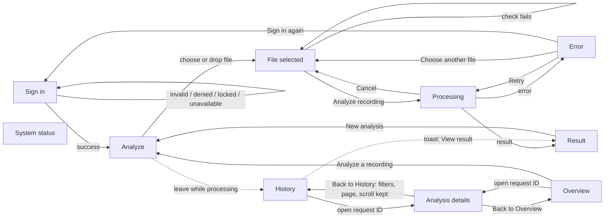

# Analyst console: design handoff (prototype v4)

Design reference for the Stage 18 React build (D38 / [ADR 0008](../decisions/0008-web-frontend-react.md)).
The prototype is [`analyst-console-prototype.html`](analyst-console-prototype.html); open it in a
browser, click **Enter demo without credentials**, and use **Prototype controls** for the other
states. The **Design system** button in the yellow banner opens the component reference page.

Everything here is a design proposal for team review. Nothing in it changes the frozen model,
the risk policy, the §11 response contract or any scientific rule. Items marked **Open decision**
are not decided by this document.

Contents: 1 Screen inventory · 2 Navigation and user flows · 3 Layout and responsive rules ·
4 Design tokens · 5 Components · 6 States · 7 Accessibility notes · 8 Content rules ·
9 Preserved from v3 · 10 New in v4 · 11 Open product decisions · 12 Developer notes ·
13 Verification report

---

## 1. Screen inventory

| # | Screen | Route (prototype) | Variants and states |
|---|---|---|---|
| S1 | Sign in | `#signin` | default, field errors, loading, invalid credentials, access denied, temporarily locked, sign-in service unavailable, expired session |
| S2 | Analyze: upload | `#analyze` | limits loading, limits loaded (mock), limits unavailable |
| S3 | Analyze: file selected | `#analyze` | all checks passed; unsupported format; file too large; recording too long; empty file; duration being read |
| S4 | Analyze: processing | `#analyze` | Validating, Uploading, Analyzing; cancelled before sending; cancelled after sending |
| S5 | Analyze: error | `#analyze` | corrupt audio, request timeout, network interruption, analysis service unavailable, expired session, unexpected service error |
| S6 | Analysis result (new) | `#analyze` | Likely synthetic voice / HIGH, Cannot decide / MEDIUM, Likely authentic voice / LOW; note saving / saved / failed |
| S7 | History | `#history` | loading, results, filtered, filtered no results, no analyses yet, failed to load; desktop table, mobile cards, mobile filter panel |
| S8 | Analysis details (stored) | `#details-<id>` | the three verdicts; opened from History or Overview; unknown request ID |
| S9 | Overview | `#overview` | loading, loaded, one figure unavailable, statistics unavailable, stale, no analyses in period; chart or table view per chart |
| S10 | System status | `#status` | Ready for analysis, Degraded, Unavailable; checking; stale status |
| S11 | Design system | `#design` | reference page for tokens and component states (prototype only, not part of the product) |
| D1 | Leave without saving note | dialog | on navigation, sign-out or Back with an unsaved note |
| D2 | Prototype controls | dialog | prototype only |
| T1 | Toast | bottom of screen | result finished elsewhere, analysis failed elsewhere, unsaved draft kept |

## 2. Navigation and user flows

Rail order: **New analysis** (primary button, strongest action) → Analyze → History → Overview →
System status. The service status line at the bottom of the rail links to System status.

Rules on every page change:
1. Navigation and content change in one render (no stale state).
2. The page scrolls to the top (except a return to History, which restores its scroll).
3. Focus moves to the page's `h1` (`tabindex="-1"`).
4. A polite live region announces "<Page name> page"; `document.title` changes.
5. Opening a stored result pushes a history entry; **Back to History** calls `history.back()`, so
   the browser Back and Forward buttons behave the same way.
6. History state (`v` verdicts, `q` search, `from`, `to`, `page`, `scroll`) lives in the history
   entry, not in global UI state. In React: keep it in the URL query (`?v=synthetic,uncertain&page=2`)
   and restore scroll from `history.state`.

## 3. Layout and responsive rules

| Width | Navigation | Layout |
|---|---|---|
| ≥ 1281 px (design at 1440) | Rail 248 px | Content max 1120 px; result + note in two columns (1.7 : 1); Overview 5 KPIs in a row; charts side by side |
| 1101–1280 px (1024 design) | Rail 232 px | Tighter page padding (24/40 instead of 32/48); 3 KPIs per row |
| 861–1100 px | Rail 232 px | Result and note stack; charts stack; panel padding 16 |
| ≤ 860 px (768 design) | Top bar with **Menu** and **New analysis**; rail becomes a drawer (scrim, Escape closes, page `inert`) | Single column; 2 KPIs per row; scenario groups stack |
| ≤ 640 px (390 design, and 200 % zoom of a 1280 px window) | Same as above; banner text shortened | Tables become cards (label left, value right); History filters behind a **Filters (n active)** toggle; every target ≥ 44 × 44 px; key-value lists stack; verdict title 23 px |

Never: horizontal page scroll; truncated verdicts, risk labels, request IDs or dates (IDs wrap with
`overflow-wrap: anywhere`); a result column narrower than 560 px or the screen width minus 40 px.

## 4. Design tokens

Screens use semantic tokens only. Raw values appear in the token definitions and nowhere else.
Names below are the CSS custom properties in the prototype; keep them in `web/src/styles/tokens.css`.

### Colour (light / dark)

| Token | Role | Light | Dark |
|---|---|---|---|
| `--bg` | page background | `#F2F4F8` | `#0D1522` |
| `--surface` | panels, cards | `#FFFFFF` | `#142033` |
| `--surface-2` | subtle fill, table header | `#F7F9FC` | `#19283E` |
| `--line` / `--line-strong` | borders / inputs, axes | `#DAE0E8` / `#B4BFCC` | `#283A54` / `#3A5070` |
| `--ink` / `--ink-2` / `--muted` | text levels | `#132033` / `#364457` / `#576476` | `#E5ECF5` / `#C3CEDC` / `#9AA9BC` |
| `--accent` / `-hover` / `-active` | primary action | `#1F49B6` / `#193C97` / `#132E75` | `#3460D6` / `#2A50BE` / `#21409A` |
| `--accent-soft` | selected, info fill | `#E7EDFB` | `#1A2B4D` |
| `--link`, `--focus` | links, focus ring | `#1F49B6` | `#9DB6FF` |
| `--danger` / `--danger-soft` | destructive action | `#A8231A` / `#FBEAE8` | `#F2958B` / `#3A1714` |
| `--nav`, `--nav-2`, `--nav-ink`, `--nav-indicator` | rail | `#13233A`, `#1C3050`, `#E2E9F2`, `#8FB0FF` | `#0A111C`, `#162741`, `#E2E9F2`, `#8FB0FF` |
| `--syn-bg` / `--syn-fg` / `--syn-mark` | Likely synthetic | `#FBE9E4` / `#872A13` / `#B23A1C` | `#3A1A12` / `#F5BBA8` / `#E0674A` |
| `--unc-bg` / `--unc-fg` / `--unc-mark` | Cannot decide | `#FCF1D7` / `#694200` / `#D08A0C` | `#382A0D` / `#F3D08A` / `#E3A32C` |
| `--auth-bg` / `--auth-fg` / `--auth-mark` | Likely authentic | `#E1F0F5` / `#0A4C62` / `#0A7FA3` | `#0F2D39` / `#98D5EA` / `#3BAFD3` |
| `--ok-*`, `--warn-*`, `--err-*` | Ready / Degraded / Unavailable | see prototype | see prototype |
| `--demo-bg` / `--demo-fg` | prototype notice | `#FFE6A6` / `#3A2900` | `#4A3A0B` / `#FFE7A8` |

### Type, space, shape

| Group | Tokens |
|---|---|
| Families | `--font-sans` IBM Plex Sans; `--font-mono` IBM Plex Mono (request IDs, versions, values) |
| Sizes | `--fs-xs 12`, `--fs-sm 13`, `--fs-base 15`, `--fs-md 17`, `--fs-lg 20`, `--fs-xl 26` (page title), `--fs-2xl 28` (verdict); line height 1.5 body, 1.2 titles |
| Space (8 px system) | `--sp-1 4`, `--sp-2 8`, `--sp-3 12`, `--sp-4 16`, `--sp-5 24`, `--sp-6 32`, `--sp-7 40`, `--sp-8 48` |
| Radii | `--r-sm 6` (buttons, inputs), `--r-md 10` (inner boxes), `--r-lg 14` (panels), `--r-pill` |
| Elevation | `--elev-1` (cards when needed), `--elev-2` (dialogs, drawer, toast, sign-in card) |
| Sizes | `--target 44` (minimum touch target), `--rail-w 248 / 232`, `--content-max 1120` |
| Motion | `--dur 150ms`, `--ease ease-out`; drawer 180 ms; all off under `prefers-reduced-motion` |

## 5. Components

The Design system page shows each component in default, hover, focus, active, disabled and
loading states. Build each as one React component in `web/src/components/`.

| Component | Variants | Rules |
|---|---|---|
| `Button` | primary, secondary, quiet, destructive, link; sizes md 44 / sm 36 (44 below 640 px) | One primary per area. Loading keeps the label, adds a spinner, sets `disabled` and blocks repeat submit. Disabled at 50 % opacity. |
| `TextField`, `DateField` | default, hover, focus, error, disabled | Label above; error = 2 px border + icon + text via `aria-describedby`; `aria-invalid`. |
| `CheckboxChip` | unchecked, checked, focus, disabled | Real `<input type="checkbox">` inside a `<label>`; count beside the label; grouped in a `<fieldset>` with a `<legend>`. |
| `VerdictPill` | synthetic / uncertain / authentic | Icon + short verdict + risk word, never colour alone. |
| `RiskLabel` | HIGH / MEDIUM / LOW | Icon (up, minus, down) + text. |
| `StatusPill` | available, partly unavailable, unavailable, checking | Icon + text. |
| `Notice`, `Banner` | info, warning, error, open-decision | Icon + text; never animated; errors use `role="alert"`, others `role="status"` only when they appear after an action. |
| `ResultCard` | three verdicts | Fixed order (section 12). Technical details collapsed. |
| `RequiredAction` | per verdict | Left bar in the verdict colour; Cannot decide uses the verdict surface and a larger title. |
| `ErrorPanel` | input, network, service | Kind badge, title, "No verdict was produced", cause, what is kept, request ID or "None", actions. |
| `DataTable` / mobile card | desktop table; card below 640 px | Same labels in both; `caption` for screen readers; request ID is the row's link. |
| `NavRail`, `NavItem`, `TopBar`, `Drawer` | default, hover, focus, current | `aria-current="page"` + bar + bold text. |
| `Skeleton`, `Stages`, `Spinner` | | Skeleton keeps the final height (no layout shift); stages show words, never percentages. |
| `EmptyState`, `ErrorState` | | Icon, title, one sentence, one action. |
| `Collapsible` | closed, open | Native `
/
`, 44 px summary, chevron. |
| `Chart` | stacked bars, share bars + marker | Every chart has a summary sentence (`aria-describedby`), a legend with icons, focusable bars with `aria-label`, and a table view toggle (`aria-expanded`). |
| `Tooltip` | | Shows on hover and keyboard focus; content duplicated in `aria-label`, so the tooltip itself is `aria-hidden`. |
| `Modal` | | Native `<dialog>` with `showModal()` (focus trapped); Escape closes; focus returns to the opener. |
| `Toast` | | `role="status"`, 9 s, optional single action, never the only place information appears. |

## 6. States (summary)

| Area | Loading | Empty | Error | Success | Degraded |
|---|---|---|---|---|---|
| Sign in | button "Signing in…" | — | 4 kinds + field errors | lands on the requested page | sign-in service unavailable |
| Upload limits | spinner line | — | limits unavailable: analysis off, Retry | limits list (mock) | — |
| Analysis | 3 stages + Cancel | — | 6 service errors + 4 browser checks | result card | analysis unavailable warning on file card |
| History | skeleton (8 rows) | no analyses; no match | failed to load + Retry | table or cards | — |
| Overview | panel skeleton | no analyses in period | statistics unavailable + Retry | figures and charts | one figure unavailable; stale banner |
| Status | "Checking…" summary and pills | — | Unavailable | Ready for analysis | Degraded; stale banner |
| Note | "Saving…" | "No note yet" | "Not saved. Your text is still here." | "Note saved hh:mm" | — |

## 7. Accessibility notes

| Interaction | Behaviour |
|---|---|
| Skip link | First focusable element; moves focus to the page `h1`. |
| Page change | Focus to `h1`, polite announcement "<Page> page", scroll to top, title updated. |
| Landmarks | `main`, `nav aria-label="Pages"`, `aside aria-label="Main menu"`, `header` (top bar), prototype `region`; one `h1` per page. |
| Menu (≤ 860 px) | `aria-expanded` + `aria-controls`; focus moves into the drawer; page behind is `inert`; Escape closes and returns focus to Menu. |
| Upload | Visible "Choose recording" button opens the picker (the file input is hidden and not focusable); drop area is optional. Each check is a list item with a hidden "Passed:" / "Failed:" prefix; failure text has `role="alert"`. |
| Processing | Stage list with `aria-current="step"`; each stage change announced politely; result and errors announced assertively; focus moves to the result title or error title. Analyze button disabled while running. |
| Result | Verdict title focusable; icon + text for verdict and risk; Technical details is a native disclosure. |
| Note | Label for the textarea; help list linked with `aria-describedby`; save outcome announced ("Note saved. The verdict and risk are unchanged." / "Note not saved…"). Unsaved changes trigger a confirm dialog on leave and a browser prompt on unload. |
| History filters | `fieldset` + `legend`; checkboxes expose state; result count announced after each change; date range error linked with `aria-describedby` and `aria-invalid`. |
| Tables | `caption`, `th scope`; on mobile, each cell carries its label. |
| Charts | Summary sentence, focusable bars with full `aria-label`, legend with icons, table alternative; scrollable table regions are focusable. |
| Dialogs | Native modal: focus trapped, Escape closes, focus returns to the opener. |
| Colour | Verdict, risk, status and chart meaning always also given by icon and text. |
| Contrast | WCAG AA in light and dark themes (axe scan, section 13). |
| Motion | Only spinners, skeletons, drawer slide and disclosure chevron; all disabled by `prefers-reduced-motion`; warnings never animate. |
| Zoom | Layout reflows at 640 px CSS width (200 % of 1280) with no horizontal scroll. |

## 8. Content rules

Use: "Likely synthetic voice", "Cannot decide", "Likely authentic voice", "Manual verification
required", "Verify through a separate channel", "Decision support only", "Calibrated model output",
"Ready for analysis", "No verdict was produced".

Avoid: "Fake detected", "Real voice", "Fraud confirmed", "Safe", "Verified", "AI confidence",
percentages for the model output, and unexplained model or engineering terms in primary text.

The model output (`confidence` in §11) appears only inside Technical details, labelled
"Calibrated model output", with its range and the three things it is not.

## 9. Preserved from v3

- Analyze as the landing page; separate Analysis details view; Back to History restoring filters,
  page and scroll; browser Back/Forward parity.
- Focus, scroll and announcement on every page change; one `h1`; `aria-current`.
- Limits from a mock `GET /limits`, analysis disabled if they cannot load; no guessed values.
- Validation before upload; nine service and input error states with their own actions; no
  verdict, risk or score on any error.
- Single request under repeated clicks and navigation; toast when the result arrives elsewhere.
- Expired session returns to the same place with the file kept.
- Notes: optional, never change the result, leave guard, failure keeps text.
- History multi-select verdict filter, date range, search, count, pagination, all states, mobile cards.
- Overview: operational figures only, range / time zone / updated time, table views, monitoring
  marker from `deferral_on_fit`.
- System status summary first, technical details collapsed.
- `risk-v1` behaviour in the mock data (synthetic always 1.00; Cannot decide 0.50–1.00).

## 10. New in v4

- **Model output moved off the main card** into Technical details as "Calibrated model output",
  with range, meaning and the three "it is not" statements; removed from the History table and the
  Overview list.
- **Result hierarchy fixed:** verdict → risk → required action → explanation → request metadata →
  technical details. Each verdict has a required-action block; Cannot decide shows "Manual
  verification required" with the three required lines.
- Verdict explanations rewritten (synthetic: does not prove fraud or identify anyone; authentic:
  does not verify identity or guarantee legitimacy, do not skip steps; Cannot decide: not a weak
  authentic result).
- Storage statement in result metadata; "Audio and original filename are not stored." on stored results.
- **Cancel analysis** (proposal) with honest outcomes before and after the request reaches the service.
- **Empty file** check; "Corrupt audio" and "Unexpected service error" wording.
- **Skip link**; dialogs return focus to their opener.
- **Theme switch** (system, light, dark) in Prototype controls; fixed a dark-mode contrast failure
  on the hovered primary button (was 4.49:1, now 7.0:1).
- **Design tokens** for colour, type, space (8 px), radii, elevation, targets and motion; screens
  use tokens only.
- **Design system page** with every component state, an example modal and toast.
- Overview: 5 figures (adds "Analyses in the period"), a definition under each, a summary sentence
  for each chart, the monitoring-marker text as agreed, time-zone choice marked as undecided.
- Status: Checking state, stale-status banner, separate checks for connection, analysis, and
  history and statistics; Degraded rule marked as an open decision.
- Sign-in: open authentication decision stated on the screen; temporarily locked wording.
- Mobile: History filters behind a toggle; 44 px targets everywhere; shortened banner.
- Navigation: "New analysis" larger (48 px) as the strongest action.

## 11. Open product decisions

Not decided here. Each is shown in the prototype as a placeholder, a mock value or a labelled proposal.

1. Production authentication and access-control mechanism (SRS §7.4; threat model §10.1). The
   sign-in screen shows one option; password recovery and sign-out confirmation depend on it.
2. Real upload limits (formats, size, duration). Mock: WAV/FLAC/MP3, 20 MB, 60 s.
3. Handling of recordings longer than 2 s (the model works on 2 s clips).
4. Fallback audio-retention behaviour if deletion after processing fails.
5. Latency target (not shown anywhere until decided).
6. Time zone used to count days in statistics (shown as UTC, labelled undecided).
7. Definition of "Degraded" (prototype proposal: analysis works, History or statistics do not).
8. Whether the calibrated model output is visible outside Technical details (prototype: no).
9. **Proposal:** Cancel analysis (stop waiting; the service may still finish and store the result).
10. **Proposal:** API endpoints beyond §11 for Stage 17: `GET /limits`, `GET /stats`, a status
    endpoint, paginated and filtered history (verdict, date range, request ID), analyst notes, and
    distinct error codes for corrupt audio, timeout, expired session and server error. §11 stays as is.

## 12. Developer notes

- **Stack (D38):** React + TypeScript (strict) + Vite, plain CSS with the tokens above. One
  `AnalysisResponse` type mirrors §11; no risk-policy logic in the browser: verdict, risk and
  output come from the API as they are.
- **Routing:** `/analyze`, `/history`, `/history/:requestId`, `/overview`, `/status`, `/signin`.
  History filters in the query string; restore scroll from `history.state`. Back to History =
  `navigate(-1)` when the details page was opened from the list, otherwise a link.
- **One request per analysis:** a single in-flight flag per selected file; the Analyze button is
  disabled while it is set; navigation does not abort or resend; the result is kept in app state
  until a new analysis starts. Cancel only stops waiting (open decision 9).
- **Errors:** map API error codes to the six error kinds; never render result components when
  the response is an error. Network failure = no request ID; service-side errors show the ID.
- **Filenames:** keep the `File` object in component state only; never send the name as metadata
  and never write it to storage.
- **Stats and limits:** read from the API; no computation of statistics in the browser.
- **Reuse:** `ResultCard` serves both the new result and Analysis details (prop `fresh`);
  `DataTable` renders both the table and the mobile card.
- **Tests to port (Vitest + Playwright, NFR-11):** the 49 checks in section 13 map one-to-one to
  end-to-end specs; add axe-core to the Playwright run.

## 13. Verification report

Run on this exact file (SHA-256 in the PR) with Playwright 1.x, Chromium, time zone Africa/Tunis,
on 2026-10-29. **49 of 49 checks passed; no console errors.**

| Area | What was checked | Result |
|---|---|---|
| Keyboard | Skip link is first and reaches `h1`; focus to `h1` on every page change; menu drawer focus in, `inert` page, Escape returns focus; dialogs trap focus and return it to the opener | Pass |
| Screen-reader behaviour (automated) | Page announcements; processing, result, error, note and filter-count announcements in live regions; one `h1`, landmarks, `aria-current`, `aria-expanded`, `aria-invalid` | Pass |
| Contrast | axe-core 4.10, WCAG 2.0/2.1/2.2 A and AA rules: 0 violations on 12 screens (sign-in, results ×2, error, History, Overview, Status, dark result, dark Overview, Design system light and dark, History at 390 px) | Pass |
| Responsive | 1440, 1024, 768, 640 (200 % zoom of 1280) and 390 px: no horizontal scroll on any page or result; History table never scrolls sideways; result column never narrow; primary action visible; 44 px targets at 390 px; History as cards | Pass |
| Duplicate requests | Repeated clicks plus navigation during processing add exactly one record; cancel before sending adds none; cancel after sending adds one in History and shows no verdict | Pass |
| Model communication | No number or score label on the main card; Technical details collapsed by default; "it is not" statements present; no score column in History | Pass |
| Reduced motion | Animations off | Pass |

**Not yet verified (required in the implementation plan):** a manual keyboard pass by a person,
a real screen-reader pass (NVDA on Windows, VoiceOver on macOS and iOS), real mouse drag-and-drop,
browser zoom in Firefox and Safari, and an interpretation test of the result screen with people
unfamiliar with the model.
