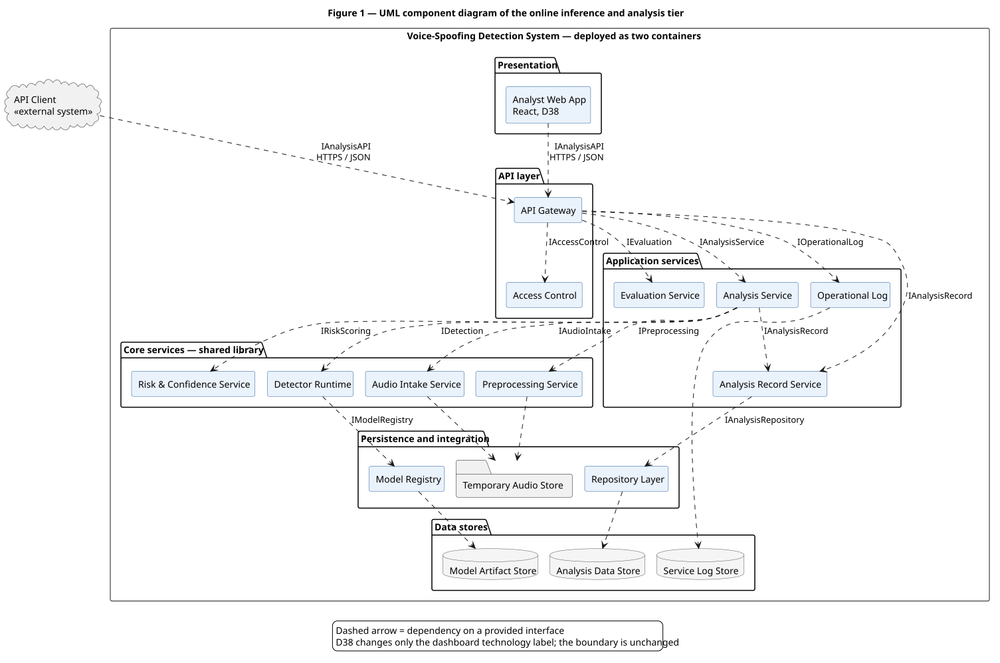
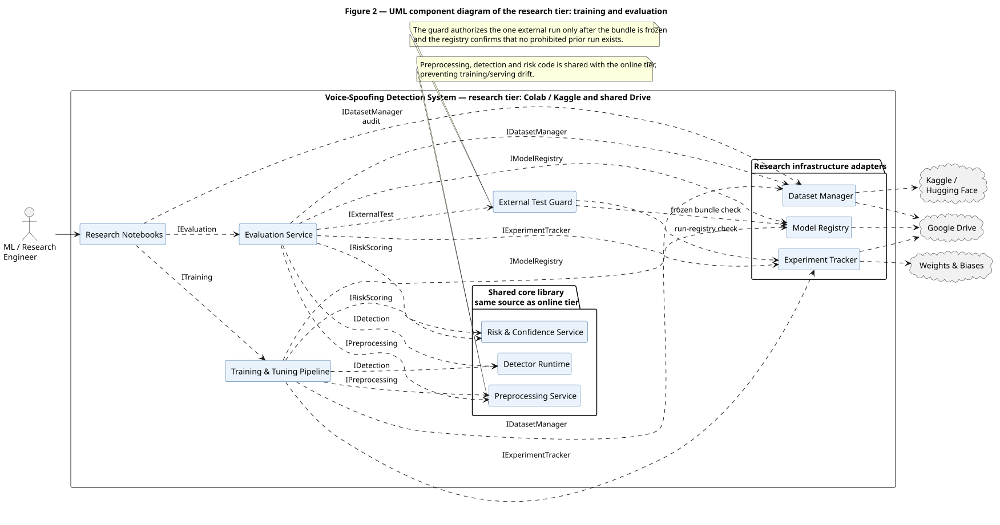
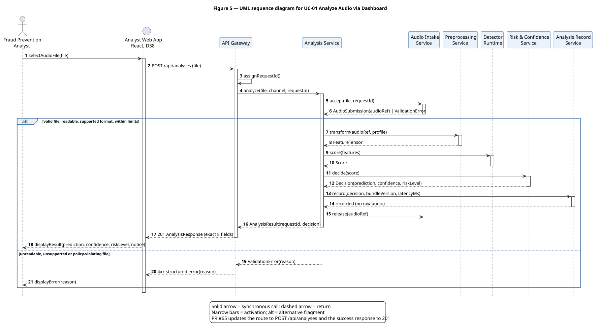
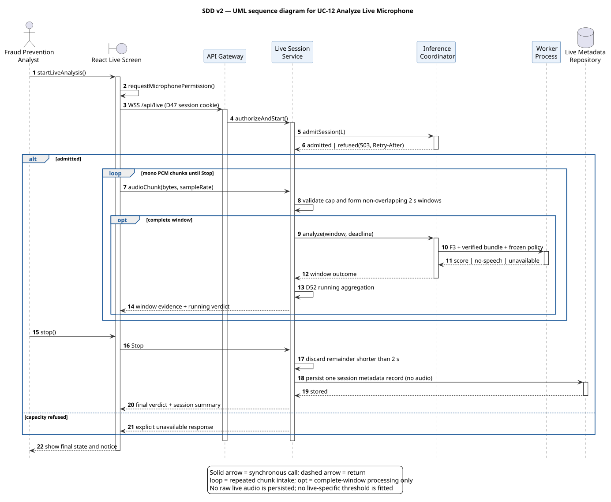
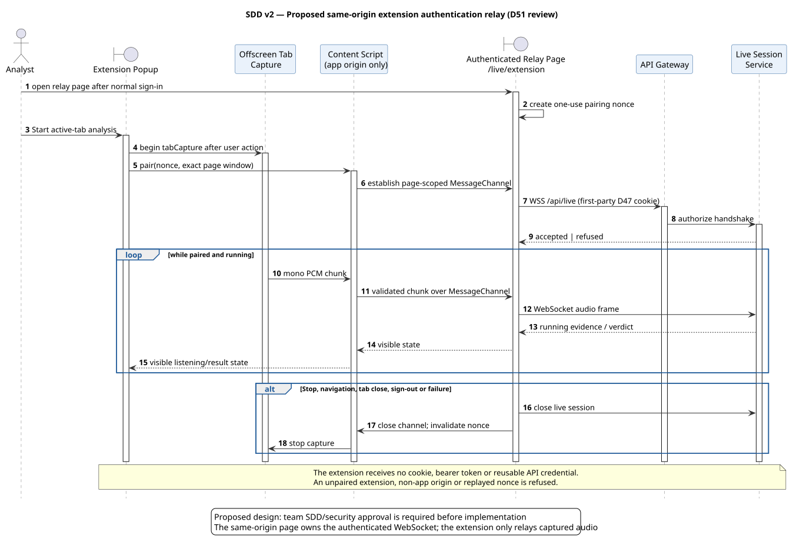
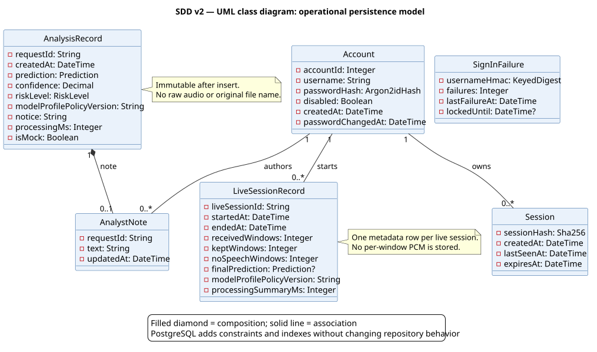
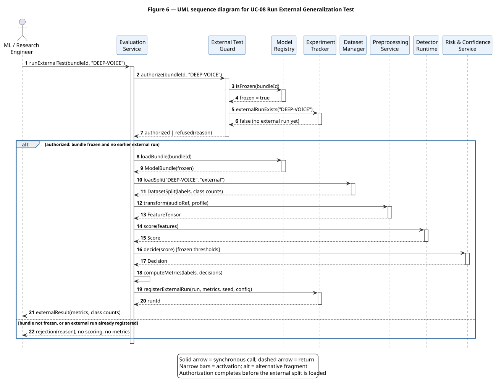
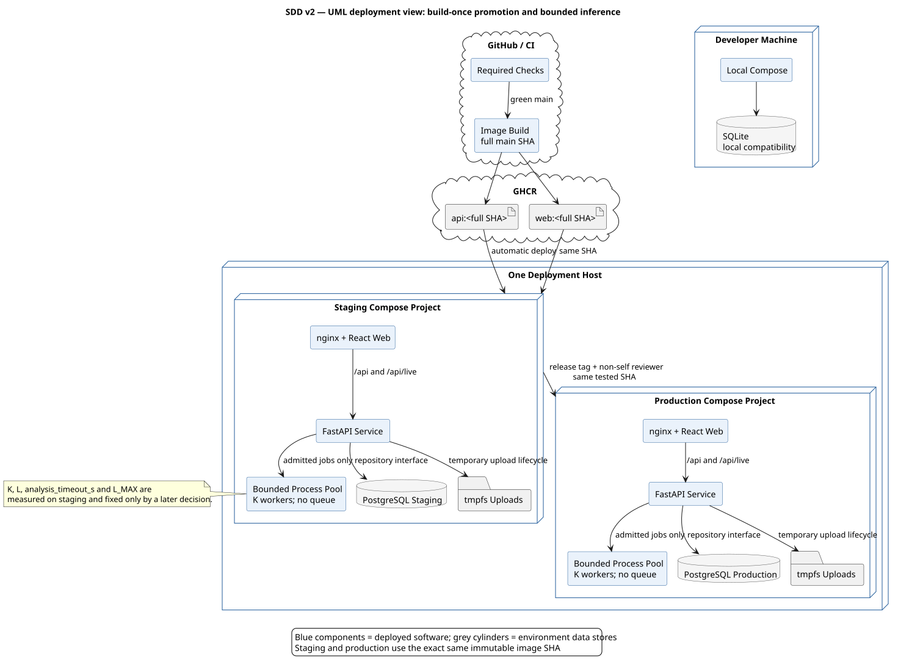
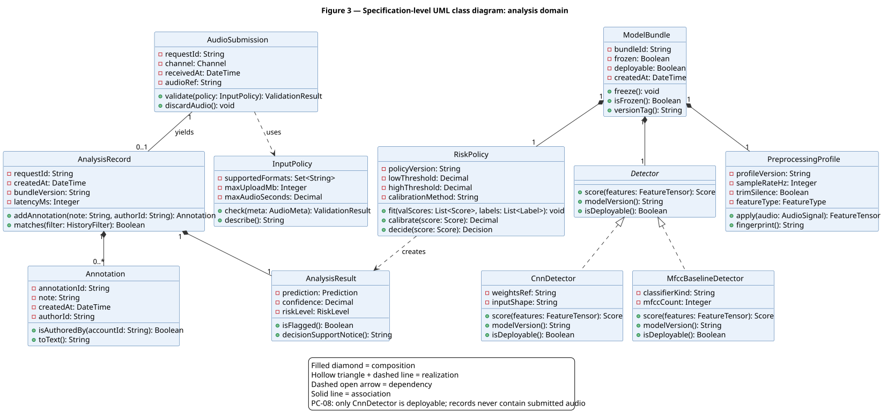
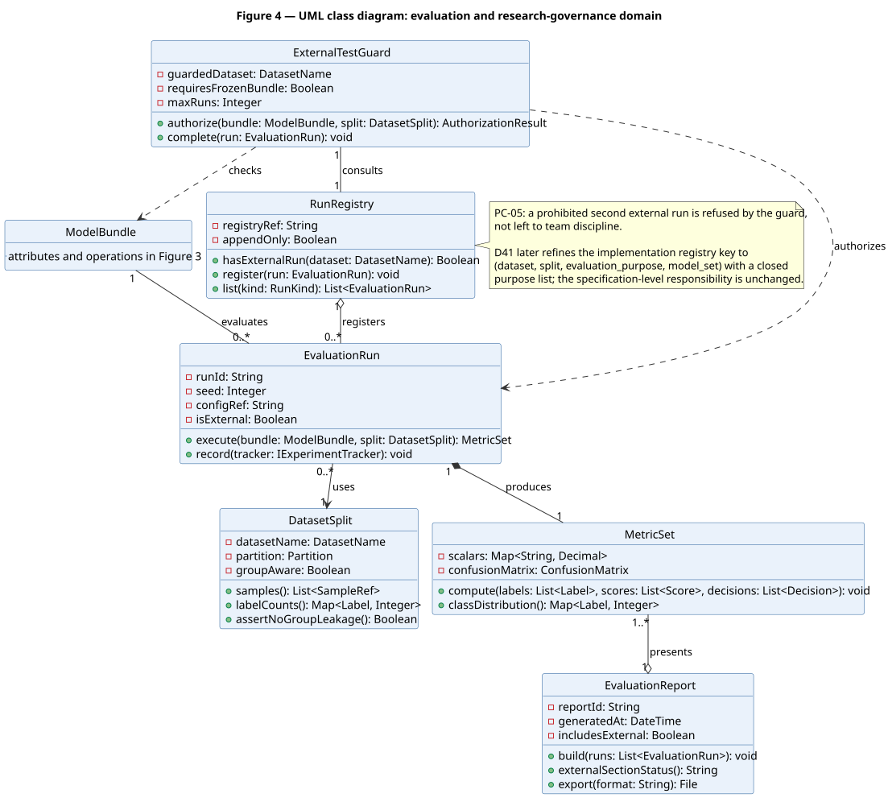

# Software Design Description

## Synthetic Speech and Voice-Spoofing Detection System

**Version:** 2.0
**Date:** 2026-11-10
**Status:** Draft for team review
**Project:** Semester AI project, MUST University
**Team:** Donia Mabrouk, Iheb Zemzemi, Malak Ben Salem, Khalil Dridi
**Primary owner:** Iheb Zemzemi
**Draft preparation:** Malak Ben Salem with AI assistance; requires human review by the owner and team

> This Markdown file is the controlling source for `SDD_v2.0.pdf`. The two files must be regenerated
> together. SDD v1.0 remains unchanged as project history.

---

## Document control

| Version | Date | Status | Description |
|---|---|---|---|
| 1.0 | 2026-09 | Superseded | Lab 5 design baseline stored as `SDD_Voice_Spoofing_Detection_Lab5.pdf`. |
| 2.0 | 2026-11-10 | Draft | Aligns the design with SRS v4.0, the current React/FastAPI MVP, and approved D38, D41 and D47-D57. |

### Approval

This draft becomes the current SDD only after the team reviews the component boundaries, security
design, traceability and implementation-status labels, the required checks pass, and the pull request
is merged. Approved decisions override this SDD if a conflict is found.

<!-- pagebreak -->

## Executive summary

The system has two connected lifecycles:

1. an **operational platform** for authenticated recording upload, live analysis, decision-support
   presentation, history, notes, status and deployment; and
2. a **research lifecycle** for governed data preparation, model-v1/model-v2 training, frozen-bundle
   evaluation, robustness, calibration, error analysis and one joint DEEP-VOICE run.

The merged MVP already provides the React/TypeScript web client, nginx, FastAPI REST service, D47
sessions, SQLite-backed repositories and a mock-analyzer seam. The approved target replaces the mock
with a verified ModelBundle, adds the D51-D52 live path, moves staging/production persistence to
PostgreSQL, isolates inference in D53's bounded process pool, and promotes immutable images through
the D54 environments. These target components are not described as implemented until their evidence
merges.

Version 2.0 preserves the v1 responsibilities while replacing obsolete Streamlit and single-process
assumptions. It also records a proposed same-origin relay design for the optional Chrome extension.
That relay keeps the D47 session cookie in the web origin and gives the extension no credential. The
team's approval of this SDD is the required D51 security-design approval; implementation remains a
separate reviewed change.

<!-- pagebreak -->

# 1. Design context

## 1.1 Purpose

This Software Design Description translates SRS v4.0 requirements into components, interfaces, data
structures, deployment units and verification responsibilities. It is a design contract, not evidence
that every target component is already implemented.

## 1.2 Authority and design principles

When documents conflict, the order is: approved decision register, current SRS, current SDD,
Execution Plan, Proposal. The design follows these principles:

- one governed inference core serves upload, API and live paths;
- raw audio is temporary for uploads and memory-only for live capture;
- every successful result carries model, profile and policy provenance;
- overload is explicit refusal, never an unbounded queue;
- one logical repository interface hides the dev/staging persistence difference;
- immutable evidence and frozen bundles are never rewritten in place;
- a result is decision support, not proof of fraud or identity;
- planned, implemented and verified are distinct states.

## 1.3 Design-status vocabulary

| Label | Meaning |
|---|---|
| Implemented | Present on the current branch and exercised by repository tests. |
| Approved target | Required by an approved decision/SRS but not necessarily merged. |
| Proposed in this SDD | Design choice awaiting the team approval that adopts this SDD. |
| Open measured value | Must be obtained by the named test/decision; never guessed. |

## 1.4 Current-to-target summary

| Area | Current merged design | Approved target |
|---|---|---|
| Web | React 19, TypeScript, Vite, nginx | D55 decision board, timeline, live screen and usability evidence |
| API | FastAPI REST under `/api`, D47 sessions | REST plus authenticated `/api/live` WebSocket |
| Analyzer | `Analyzer` protocol and `MockAnalyzer` | Loader-verified F4, then F5 ModelBundle inference |
| Isolation | thread-based timeout seam in the MVP | bounded process pool of measured K workers; no queue |
| Persistence | SQLite behind repository classes | PostgreSQL in staging/production; SQLite permitted for local compatibility |
| Environments | local Compose and CI/e2e | dev, staging, production; build once and promote exact SHA |
| Research | v1 pipeline, registries and reports | model-v2 augmentation/candidates plus joint external run |
| Browser extension | not implemented | optional MV3 active-tab capture after approved relay security design |

# 2. Architecture overview

## 2.1 Online application component view

<!-- pagebreak -->

## 2.2 Research component view

The two figures above are reused from the canonical UML package rather than redrawn. The v2 runtime,
live-analysis and persistence additions are specified by the new diagrams later in this document, using
the same visual language and notation rules.

<!-- pagebreak -->

## 2.3 Responsibility boundaries

| Component | Owns | Must not own |
|---|---|---|
| React SPA | analyst interaction, client validation, session states, decision board/timeline | model inference, policy recomputation, secrets |
| nginx | TLS termination, SPA/static delivery, same-origin API/WebSocket proxy | business decisions or persisted sessions |
| FastAPI service | input policy, session authorization, orchestration, response contract, persistence calls | unbounded work or browser-only state |
| Inference coordinator | admission, worker lifecycle, deadline and refusal | SQL, HTTP response rendering, queues |
| Worker process | F3 preprocessing, verified bundle scoring, calibration/risk decision | persistence or request authentication |
| Repository interface | analyses, notes, accounts, sessions, failures and live metadata | raw audio or model tensors |
| Research pipeline | audit, manifests, training, evaluation, reports and freezes | operational session data or silent rule changes |
| CI/CD | build, test, publish, promote, smoke test and rollback | rebuilding per environment or embedding secrets |

# 3. Operational component design

## 3.1 Web application

The web client uses React Router and a session guard. Every application route except `/signin` requires
`GET /api/session` to establish the current state. The API client accepts only relative `/api/` paths,
sends same-origin credentials, parses structured errors and never stores a password or session token.

| Web area | Current responsibility | Target addition |
|---|---|---|
| Session store/guard | checking, signed-in, signed-out; expiry handling | unchanged |
| Analyze | file checks, duration read, one upload, explicit result/error states | D55 decision board and upload timeline |
| History/details | newest-first list, filters/pagination, result and analyst note | D55 consistent decision board |
| Status/overview | service status, limits, aggregate figures | capacity/refusal indicators without sensitive logs |
| Live | not implemented | Start/Stop, permission, listening state, per-window timeline and running verdict |
| Accessibility | axe and 390 px e2e coverage | WCAG 2.0/2.1/2.2 A/AA and moderated D55 evidence |

The web client displays server-provided verdict, score, provenance and notice. It does not calculate a
new threshold, risk level or final verdict.

## 3.2 HTTP API

The current REST contract remains under `/api`:

| Method and path | Responsibility | Session |
|---|---|---|
| `GET /api/health` | liveness only; no private state | no |
| `GET /api/session` | return active analyst session | yes by definition |
| `POST /api/session` | sign in and create server session | no existing session required |
| `DELETE /api/session` | invalidate current session | yes |
| `GET /api/status` | service/analyzer/store state | yes |
| `GET /api/limits` | server upload policy | yes |
| `POST /api/analyses` | validate, score and persist one recording | yes |
| `GET /api/analyses` | filtered/paged history | yes |
| `GET /api/analyses/{request_id}` | one immutable result plus note | yes |
| `PUT /api/analyses/{request_id}/note` | save/replace/delete own analyst note | yes |
| `GET /api/stats` | approved aggregate statistics | yes |
| `WS /api/live` | approved target live stream/result channel | yes at handshake |

Every error uses the structured error envelope and a stable code. Internal exceptions, filesystem
paths, SQL, stack traces and secrets never reach the client.

## 3.3 Service layer

The target service layer separates transport from orchestration:

| Service | Main operations |
|---|---|
| `SessionService` | sign in/out, validate, touch, expire, lock/unlock through repositories |
| `AnalysisService` | validate upload, create request ID, temporary intake, request inference, persist success, release audio |
| `HistoryService` | query results, details, notes and aggregate statistics |
| `LiveSessionService` | authorize handshake, validate messages, build D52 windows, request inference, aggregate verdict, persist metadata |
| `StatusService` | probe repository, bundle and pool without exposing sensitive data |
| `InferenceCoordinator` | admit or refuse work, enforce deadlines, restart terminated workers and report capacity |

Transport routers convert HTTP/WebSocket data into service calls. Services depend on protocols and do
not import concrete SQLite/PostgreSQL drivers or UI types.

## 3.4 Inference isolation and capacity

Under D53, upload analyses and live windows use one bounded process pool:

- pool size is K, set only after the staging load test;
- each worker uses the CPU build and one torch thread;
- no task waits in an application queue;
- when all K workers are busy, an upload receives `503` plus `Retry-After`;
- at most L live sessions are admitted, with the same refusal behavior beyond L;
- a task exceeding `analysis_timeout_s` terminates its worker; replacement occurs before new work;
- the live message-size cap is configured and tested before live acceptance;
- GPU use requires a later decision only if measured p95 window latency exceeds one second.

`K`, `L`, `analysis_timeout_s` and `L_MAX` remain open measured values. This SDD deliberately assigns
no numeric defaults to the target deployment.

## 3.5 Analyzer and bundle adapter

The existing `Analyzer` protocol remains the service seam. The target adapter:

1. loads F4 or F5 only through the verifying ModelBundle loader;
2. checks every manifest component and hash before activation;
3. applies the bundle-bound F3 preprocessing profile;
4. produces raw score, calibrated probability where applicable, verdict, confidence, risk and
   provenance using the frozen policy;
5. reports unavailable rather than falling back to a mock or stale bundle.

The `is_mock` field remains explicit while the mock exists. A mock result may support UI/demo work but
must never be labelled as detector evidence.

<!-- pagebreak -->

# 4. Interface and behavior design

## 4.1 Upload-analysis sequence

<!-- pagebreak -->

## 4.2 Live-analysis sequence

The server returns warm-up evidence and no final verdict before three kept windows. The final result is
the D52 aggregation of kept windows; no live-specific threshold is fitted.

## 4.3 Session lifecycle

Sessions are server-side. The browser receives an opaque cookie with `Secure`, `HttpOnly`,
`SameSite=Strict` and `Path=/api`. The store keeps only SHA-256 of the session identifier. Idle and
absolute expiry, account disable/password change, sign-out and administrator actions invalidate
sessions. Sign-in uses Argon2id, generic error messages, keyed username-HMAC failure rows, lockout and
next-sign-in rate limiting. No client IP, user agent, clear password or clear session ID is stored.

## 4.4 Proposed extension authentication relay

The optional extension cannot safely call `/api/live` directly with D47's strict same-site cookie. A
free-text Origin allowlist or an extension-held bearer token would weaken the approved session model.
This SDD therefore proposes the following same-origin relay:

1. The analyst signs into the normal web app and opens `/live/extension`.
2. A content script is permitted only on the configured Voice Check web origin. It creates a private
   runtime port to the extension's offscreen capture document after an explicit user click.
3. The same-origin web page, not the extension, opens `WSS /api/live`; the D47 cookie therefore remains
   first-party and `Origin` is the approved web origin.
4. Captured mono PCM moves extension -> content script -> page through an ephemeral, page-scoped
   `MessageChannel`. The page forwards chunks to its WebSocket. No session cookie or reusable API token
   is exposed to extension JavaScript.
5. The bridge accepts messages only from the exact page window and exact configured origin, validates a
   one-use random pairing nonce, checks message shape/size, and closes on Stop, navigation, tab closure,
   sign-out or WebSocket failure.
6. The extension permissions are limited to `activeTab`, `tabCapture`, `offscreen` and the one web-app
   host permission. It has no broad browsing-history permission and stores no audio.
7. Captured tab audio is routed back to the user, the listening indicator is visible in both extension
   and page, and capture begins only after the user action.

Security-review acceptance tests must prove: an unpaired extension cannot send audio; a non-app page
cannot create a bridge; a replayed nonce fails; oversized or malformed messages close the channel; the
cookie/token is never observable by the extension; Stop and sign-out close both channels; and no PCM is
written to browser or server storage. Team approval of SDD v2.0 approves this relay design. Any direct
extension credential or different origin model requires a new decision before implementation.

# 5. Data design

## 5.1 Repository abstraction

Domain services depend on repository protocols. Local development may use the current SQLite adapter.
Staging and production use PostgreSQL adapters implementing the same behavior and transaction rules.
SQL and driver exceptions are converted to service errors at the adapter boundary.

<!-- pagebreak -->

## 5.2 Logical schema

`analysis_record` remains immutable after insert. A note is mutable but separate and records its last
author/update. The live table stores one metadata row per session and no per-window PCM. The exact
PostgreSQL migration adds constraints and indexes equivalent to the current repository behavior; it
does not silently change API semantics.

## 5.3 Privacy and retention

Never stored: raw live audio, uploaded audio after the configured temporary lifecycle, original file
name, client IP, user agent, clear password, clear session ID, note text in logs, model weights in the
database, or audio bytes in logs/traces. Staging uses only synthetic/provided demo audio and test
accounts. Production retention settings and backup handling require deployment documentation before
acceptance.

## 5.4 Migration strategy

The migration from SQLite to PostgreSQL is explicit and reversible:

- freeze the schema mapping and migration tool version;
- export existing non-audio rows with counts and hashes of canonical exports;
- import into an empty PostgreSQL schema inside one controlled migration;
- verify row counts, constraints, foreign keys and representative repository queries;
- run API integration tests against a PostgreSQL service container;
- retain the pre-migration SQLite file read-only until the reviewed rollback window closes;
- record the migration result without committing real operational data.

<!-- pagebreak -->

# 6. Research and model lifecycle design

## 6.1 Governed evaluation and external-run sequence

D48 extends the guarded pass to the eligible F4/F5 and baseline columns, but does not change the
canonical order: authorization and registry checks happen before model loading or dataset access, and
the single pass produces immutable evidence rather than feeding model selection.

## 6.2 Model-v2 controls

- Candidates are exactly `cnn-aug`, `crnn` and `aasist`.
- D50/D56 augmentation is on-the-fly, train-only and equally available to both classes.
- MUSAN/RIRS_NOISES licence, hashes and seeded halves are pinned before use.
- RawBoost algorithm 1 is implemented from the paper and checked against the pinned reference on
  synthetic signals; algorithm 3 is not used.
- Each of seven codec options is selected with probability 1/7 when the codec family is drawn.
- Selection set S is fixed from val-A with seed 2026; test/external results never select a candidate.
- The winner receives two additional seeds, then bundle-seed calibration/policy and F5 freezing.

## 6.3 Registries and immutable evidence

D41 permits exactly the closed purposes `stage11_test` and `stage14_robustness`. Stage 14 runs the full
pre-declared condition grid once per frozen model set and reuses clean per-clip scores from Stage 11.
Any other purpose is refused unless a later approved decision changes the closed list. Stage 13 remains
the single joint dataset-wide DEEP-VOICE pass under D35/D48.

Every report identifies dataset, split, bundle/config/commit, seed, class/group counts, metric units,
CI method, invalid resamples, limitations and artifact hashes. Reports do not rewrite manifests or
choose models after test access.

## 6.4 Operational bundle handoff

Research output reaches the API only as a verified F4/F5 bundle. Promotion copies no loose checkpoint
or mutable config. The operational loader rejects missing, extra or mismatched files. Activating F5
replaces F4 only when F5 exists and verifies; the baseline is never deployed.

<!-- pagebreak -->

# 7. Deployment and environment design

## 7.1 Environment topology

## 7.2 Build and promotion

CI builds API and web images once for each accepted main commit, tags them with the full SHA and
publishes them to GHCR. Staging deploys that SHA after required checks. Production accepts only a
release tag whose images already ran in staging and requires a non-self reviewer. Every deploy runs
health and smoke checks; failure redeploys the previous SHA. Promotion never rebuilds.

## 7.3 Configuration and secrets

Configuration is environment-specific but schema-validated. Secrets are GitHub Environment/host
secrets: session HMAC key, database password and deploy key. They never appear in images, Compose files,
logs or repository history. Both deployed environments use HTTPS and a `Secure` session cookie.

The hosting provider remains open until Iheb verifies the free-tier/student-credit choice and records
the D54 amendment. This SDD names no provider.

<!-- pagebreak -->

## 7.4 Capacity test design

On the staging host with the deployed bundle, the documented load test mixes maximum-size uploads and
candidate live-session counts. It records hardware/software versions, pool size, request mix, response
codes, latency percentiles, resource use, timeouts and refusal behavior. A later decision records K, L,
`analysis_timeout_s`, `L_MAX` and tmpfs sizing. Production acceptance waits for that decision.

# 8. Security design

## 8.1 Trust boundaries

Trust boundaries exist at browser/nginx, nginx/API, API/worker, API/database, CI/registry and
staging/production. Browser inputs, uploaded bytes, WebSocket messages, bundle files, environment
configuration and migration inputs are untrusted until validated.

## 8.2 Controls

| Threat | Control |
|---|---|
| Session theft | opaque Secure/HttpOnly/SameSite cookie, server-side hash, expiry, invalidation |
| Cross-origin request | exact Origin allowlist, same-origin client paths, strict cookie, extension relay design |
| Brute force | generic responses, Argon2id, keyed failure rows, lockout and rate limiting |
| Oversize/malformed audio | streamed byte cap, decoded-duration/type checks, live message cap |
| Inference exhaustion | K/L admission, no queue, deadline, killable worker, `503 Retry-After` |
| Bundle tampering | verifying loader and hashes before activation |
| SQL injection | repository parameters and schema constraints; no client SQL |
| Secret leakage | environment secrets, redacted structured logs, token scan, no stack traces |
| Audio/privacy leakage | temporary/memory-only handling, no audio columns or logs, demo-only staging |
| Supply-chain drift | pinned dependencies/images, build-once SHA promotion, CI and reviewed release |

## 8.3 Logging and observability

Operational logs use request/session correlation identifiers that are not credentials. Allowed fields
include route category, status, duration, bundle/profile/policy versions, refusal reason and aggregate
capacity. Forbidden fields include audio, note text, passwords, session cookies/IDs, raw account names
in failed sign-in logs, client IP, stack traces in responses and model tensors.

<!-- pagebreak -->

# 9. Class and protocol design

## 9.1 Analysis-domain classes

<!-- pagebreak -->

## 9.2 Evaluation and governance classes

## 9.3 Key protocol invariants

- `AnalysisOutcome` is created only by the active analyzer and includes provenance.
- an `AnalysisRecord` is inserted only after successful inference;
- a failed/refused request creates no successful record;
- notes never mutate the analysis row;
- repository implementations produce the same ordered/filter/pagination behavior;
- `InferenceCoordinator` admits at most K active jobs and never accumulates a hidden queue;
- live aggregation accepts only D52-compliant complete windows;
- stopping a live session is idempotent and persists metadata at most once;
- mock and verified analyzer states are explicit and never silently substituted.

# 10. Failure handling

| Failure | Required behavior |
|---|---|
| Invalid/oversize/unsupported upload | stable 4xx, no inference, no successful record, temporary bytes removed |
| Expired/invalid session | stable 401; client returns to sign-in without exposing details |
| Unauthorized origin | refuse before route/live processing |
| Pool full/live limit reached | `503` plus `Retry-After`; no application queue |
| Worker deadline/crash | terminate/restart worker; explicit unavailable response; no success record |
| Bundle verification failure | analyzer unavailable; never fall back to mock/stale bundle |
| Database unavailable | status degraded/unavailable; structured failure; no fabricated success |
| WebSocket malformed/oversize message | close with documented safe code; no stored audio/result |
| Staging/production smoke failure | redeploy prior SHA and record the failure |
| Research registry refusal | stop before scoring and preserve immutable registry/evidence |

# 11. Verification strategy

## 11.1 Test layers

| Layer | Required evidence |
|---|---|
| Unit | config/schema validation, repositories, services, D52 aggregation, model/profile/policy adapters |
| Contract/integration | FastAPI schemas/errors, SQLite and PostgreSQL adapters, WebSocket handshake/messages |
| Security/governance | Origin/cookie/lockout, token scan, DEEP-VOICE guard, registry refusal, extension relay abuse cases |
| Web | component/state tests, API parser tests, navigation/session/error flows |
| E2E | real nginx/API/web stack in Chromium, upload/history/status/sign-in, live flow when implemented |
| Accessibility | axe WCAG 2.0/2.1/2.2 A/AA in light/dark plus 390 px checks |
| Performance | staging K/L/timeout/L_MAX load test with deployed bundle |
| Research | deterministic manifests/hashes, synthetic augmentation tests, frozen-run/report checks |
| Usability | D55 fixed script, 3-5 outside participants, task success and SUS target |

## 11.2 Extension security gate

No extension code is accepted until the relay threat model, permissions, pairing, origin checks,
message caps, lifecycle cleanup and no-storage evidence pass review. A direct API call from the
extension is a design change and requires a new decision.

## 11.3 PostgreSQL gate

The PostgreSQL adapter must pass the same repository/API suite as SQLite plus migration, concurrent
writer, transaction rollback and service-container tests. The local SQLite adapter may remain for dev,
but staging/production cannot claim D53 compliance while using it.

# 12. Traceability

## 12.1 SRS-to-design map

| SRS v4.0 group | Primary design sections |
|---|---|
| FR-01-FR-11 | 3.1-3.3, 4.1, 5, 9-10 |
| FR-12-FR-20 | 6, 9-11 |
| FR-21 | 3.1-3.3, 4.3, 5.2, 8 |
| FR-22-FR-25 | 3.1-3.4, 4.2, 5.2, 8-10 |
| FR-26 | 4.4 and 8.1-8.2, subject to security gate |
| FR-27-FR-29 | 6.1-6.4 |
| FR-30-FR-31 | 3.1-3.2 and D55 verification in 11.1 |
| FR-32 | 7.1-7.3 |
| NFR-01, NFR-14-NFR-17 | 3.4, 5, 7.4, 10-11 |
| NFR-02-NFR-13, NFR-18-NFR-20 | 4-5, 8, 10-11 |
| PC-01-PC-19 | 6 and 11, with the decision register/registries as authority |

## 12.2 v1-to-v2 change map

| SDD v1 assumption | SDD v2 treatment | Authority |
|---|---|---|
| Streamlit presentation | React/TypeScript SPA through nginx | D38 |
| upload-only operational path | upload plus approved live WebSocket path | D51-D52 |
| one CNN/external model | v1 plus governed v2 candidates and joint run | D48-D50 |
| in-process/thread inference | bounded killable process pool; no queue | D53 |
| SQLite deployment store | PostgreSQL in staging/production behind repositories | D53 |
| local/single environment | dev, staging, production with immutable promotion | D54 |
| generic result dashboard | decision board, timeline, live screen, usability evidence | D55 |
| no extension auth design | proposed same-origin relay with no extension credential | D51, this SDD |

# 13. Open parameters and implementation plan

## 13.1 Open values and decisions

| Topic | Current state | Closure rule |
|---|---|---|
| K, L, `analysis_timeout_s`, `L_MAX`, tmpfs size | not measured | staging D53 load test, then approved decision |
| Live message cap and retry guidance | not fixed | SDD/API config implementation plus boundary/refusal tests |
| Hosting provider | not selected | Iheb verifies free option and records D54 amendment |
| Extension relay | proposed here | all-team SDD/security approval before code |
| F5 bundle | not yet frozen | D49/D50/D56 selection/training/freeze gates |
| Production retention/backup | not yet recorded | deployment/security documentation before production acceptance |

## 13.2 Implementation order

1. keep current API/web contract green while adding repository/service protocols;
2. implement and parity-test PostgreSQL adapters and migration;
3. implement the process pool and overload/deadline behavior;
4. integrate the verified F4/F5 analyzer adapter;
5. implement `/api/live` and web microphone flow under D52;
6. run staging load tests and record measured limits;
7. implement D55 redesign/evidence;
8. implement the optional extension only after relay security approval;
9. complete staging/production promotion, smoke tests and rollback;
10. update status/evidence in append-only project records.

# 14. Review and sign-off

| Reviewer | Review responsibility | Status |
|---|---|---|
| Iheb Zemzemi | SDD owner: API, live analysis, PostgreSQL/process pool, deployment and extension design | Pending |
| Donia Mabrouk | model-v2 lifecycle, protocol, registries, joint external run and traceability | Pending |
| Khalil Dridi | SRS alignment, infrastructure/security constraints and report wording | Pending |
| Malak Ben Salem | D50/D56, Stage 14, version index and document-pair consistency | Draft prepared |

Approval means the reviewer confirms that the SDD matches approved requirements, distinguishes current
and target state, and introduces no unapproved result, capacity value, provider or data access.
