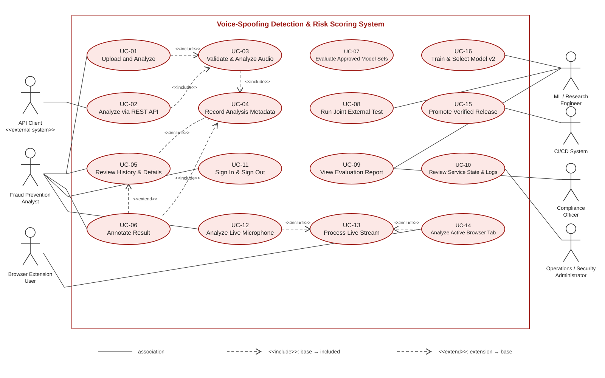

# Software Requirements Specification

## Synthetic Speech and Voice-Spoofing Detection System

**Version:** 4.0
**Date:** 2026-11-10
**Status:** Draft for team review
**Project:** Semester AI project, MUST University
**Team:** Donia Mabrouk, Iheb Zemzemi, Malak Ben Salem, Khalil Dridi
**Primary owner:** Khalil Dridi
**Draft preparation:** Malak Ben Salem with AI assistance; requires human review by the owner and team

> This Markdown file is the controlling source for `SRS_v4.0.pdf`. The two files must be regenerated
> together. SRS v3.0 remains unchanged as project history.

---

## Document control

| Version | Date | Status | Description |
|---|---|---|---|
| 3.0 | 2026-09 | Superseded | Merged Lab 3 requirements baseline, stored as `SRS_Voice_Spoofing_Detection.pdf`. |
| 4.0 | 2026-11-10 | Draft | Preserves the v3 requirement identifiers, incorporates approved D47-D57, and aligns the requirements with the current React/FastAPI platform and Execution Plan v3.0. |

### Approval

This draft becomes the current SRS only after the team reviews the requirement wording and traceability,
the required checks pass, and the pull request is merged. Until then, approved decisions override both
SRS versions.

<!-- pagebreak -->

## Executive summary

The system is a decision-support control for fraud-prevention analysts. It analyses uploaded speech or,
within the approved live scope, microphone or browser-tab audio. It returns one of three outcomes -
`authentic`, `synthetic`, or `uncertain` - together with a calibrated probability, confidence, a
LOW/MEDIUM/HIGH risk level, provenance, and a decision-support notice. It does not make an automatic
fraud decision and is not a biometric authenticator.

Version 4.0 keeps the complete SRS v3.0 baseline and records the approved changes made since it:

- React and TypeScript replace the old Streamlit dashboard assumption (D38).
- Analyst sign-in uses admin-created accounts and server-side sessions (D47).
- Model v1 and model v2 have separate frozen bundles; model v2 is selected only from the three D49
  candidates and uses the D50/D56 augmentation design.
- The one DEEP-VOICE access becomes a joint external run for the frozen v1 bundle, frozen v2 bundle if
  ready by the cut-off, and `baseline-v1` (D48).
- Live microphone analysis and a session-protected WebSocket endpoint are Must requirements; a Chrome
  Manifest V3 tab-capture extension is Should; native phone-call capture is excluded (D51-D52).
- PostgreSQL, a bounded process pool, measured capacity limits, and dev/staging/production environments
  replace the earlier SQLite/single-environment design for staging and production (D53-D54).
- The analyst interface adds a decision board, per-window timeline, live screen, accessibility evidence,
  and a moderated usability test (D55).

The requirements remain subordinate to the approved decision register. Implementation status is not a
requirement claim: a requirement may be approved while its implementation is still planned.

<!-- pagebreak -->

# 1. Introduction

## 1.1 Purpose

This Software Requirements Specification defines the required behavior, quality attributes, research
constraints, interfaces, and acceptance criteria for the Synthetic Speech and Voice-Spoofing Detection
System. It is the requirements baseline for development, verification, usability evaluation, and final
delivery after the midterm.

The intended readers are the four project members, the course instructor, reviewers, and AI-assisted
development tools operating under `AGENTS.md`.

## 1.2 Scope

### In scope

- Short recorded-audio analysis through the analyst web application and REST API.
- Live microphone analysis through the web application.
- A session-protected streaming endpoint under `/api/live`.
- A Chrome Manifest V3 active-tab audio extension as a Should requirement, subject to a separate
  authentication/security design review before implementation.
- One classical evaluation-only baseline, one model-v1 CNN, and one model-v2 winner selected from
  `cnn-aug`, `crnn`, and `aasist`.
- Three-way decision support with calibrated probability, confidence, risk, threshold, uncertain band,
  and model/profile/policy provenance.
- Analysis history, details, analyst notes, service status, aggregate statistics, and operational logs.
- FoR-2sec development, Stage 11 internal testing, Stage 14 robustness, Stage 15 calibration, Stage 16
  error analysis, and one joint DEEP-VOICE external run.
- Local development, staging, and production environments using promoted container images.

### Out of scope this semester

- A native mobile application or mobile share target.
- Capturing native mobile phone calls or in-app mobile call audio.
- Production biometric authentication or an automatic fraud/blocking decision.
- Adversarial-evasion defence, replay-attack defence, speaker identity verification, or case management.
- Additional speech datasets, a second external dataset, ensembles, or unapproved model families such as
  XLS-R, wav2vec2, WavLM, HuBERT, or RawNet.
- A second API host, distributed queue, or message broker without a new measurement-backed decision.

## 1.3 Requirement language and evidence labels

`Shall` means mandatory for the stated release or gate. `Should` means planned but allowed on the approved
cut line. `Could` means optional and cannot delay a Must. `Won't` means excluded from this release.

Evidence labels used by the project remain:

- **[verified]** checked against data, code, tests, or a primary source;
- **[doc]** stated by an approved project document;
- **[hypothesis]** pre-registered but not yet tested;
- **[to verify]** unresolved and not to be presented as fact.

## 1.4 Definitions

| Term | Definition |
|---|---|
| Analyst | Fraud-prevention user who signs in, analyses audio, reviews results, and writes notes. |
| Authentic / synthetic / uncertain | The three mutually exclusive decision-support verdicts. |
| Calibrated probability `p` | Bundle-seed score after the approved Platt calibration rule. |
| Confidence | Numeric value in `[0,1]` returned with a verdict. It is not proof of correctness. |
| Risk level | LOW, MEDIUM, or HIGH from the frozen risk policy. |
| Decision board | UI scale showing `p`, the frozen threshold, uncertain band, and a Why panel. |
| ModelBundle | Frozen checkpoint, F3 preprocessing profile, and risk policy with verified hashes. |
| F3 | Approved preprocessing profile: 16 kHz target, F3 trimming/feature rules, and `soxr_hq` where resampling is required. |
| F4 / F5 | Frozen ModelBundle v1 / v2. |
| `baseline-v1` | Evaluation-only MFCC mean+std and RBF-SVM baseline. |
| Model v1 | Four-block CNN on F3 log-Mel features. |
| Model v2 | Winner among `cnn-aug`, `crnn`, and `aasist`, selected under D49. |
| FoR-2sec | Development speech dataset used for training, validation, calibration, and controlled test work. |
| DEEP-VOICE | External RVC dataset accessed for audio scoring exactly once through the guarded joint run. |
| Live window | Non-overlapping 2-second audio window processed under D52. |
| Kept window | Live window with at least 50% speech frames under the F3 detector. |
| Running verdict | Frozen threshold and band applied to the mean calibrated `p` over all kept windows so far. |
| Selection set S | Fixed val-A conditions in D50: clean, noise 10 dB, reverberation, Opus 16 kbps, and narrowband telephony. |

## 1.5 References and authority

When documents conflict, the priority is: approved decision register, current SRS, current SDD,
Execution Plan, Proposal. Conflicts are never resolved silently.

| Reference | Role |
|---|---|
| `docs/decisions/README.md` | Authoritative D-IDs, H-IDs, statuses, and amendments. |
| `docs/experimental_protocol.md` | Frozen experimental protocol F1 plus approved addenda. |
| `docs/reference/Execution_Plan_v3.0.md` | Owners, tracks, gates, dates, and cut line. |
| `docs/api_design.md` | Approved HTTP contract and current endpoint shapes. |
| `docs/model_bundle.md` | Bundle format and verifying loader. |
| `docs/threat_model.md` | Assets, threats, safeguards, and accepted risks. |
| `docs/reference/SRS_Voice_Spoofing_Detection.pdf` | Historical SRS v3.0. |
| D38, D41, D47-D57 | Approved changes relevant to this SRS. |

# 2. Overall description

## 2.1 Product perspective

The product has two related lifecycles sharing one governed inference core:

1. **Operational platform:** React web client and external API clients reach the FastAPI service through
   nginx. Upload and live requests use the active verified bundle, and metadata is persisted without raw
   audio.
2. **Research lifecycle:** audited datasets, reproducible training/evaluation runners, registries,
   manifests, reports, and frozen bundles. Research results never change the already pre-declared test or
   deployment rules after the fact.

The current merged MVP uses a mock analyzer. D48 requires the verified F4 bundle to replace it, then F5
to replace F4 by rule. This document specifies the target system and does not mislabel the mock as a real
detector.

## 2.2 User classes and external actors

| Actor | Goals and permissions |
|---|---|
| Fraud Prevention Analyst | Sign in, upload audio, run live analysis, read the decision board, review history/details, and write or remove own operational note. |
| API Client | Submit supported recordings and consume structured analysis responses under the same policy as the web client. |
| Operations/Security Administrator | Create/disable/unlock accounts, inspect service state/logs, deploy approved images, and respond to outages. |
| Compliance Officer / Reviewer | Verify decision-support wording, privacy behavior, provenance, evaluation reports, and documented limitations. |
| ML / Research Engineer | Audit permitted data, train and evaluate approved models, create frozen bundles, and produce reproducible evidence. |
| CI/CD system | Build, test, publish, promote, smoke-test, and roll back exact container images under D54. |
| Chrome extension user | Explicitly start/stop active-tab capture after seeing consent/privacy guidance. |

## 2.3 Operating environment

- Browser: modern Chromium for the web app; Chrome Manifest V3 for the optional extension.
- Backend: Python 3.13, FastAPI, PyTorch CPU build for operational inference unless D53's measured GPU
  trigger is met.
- Frontend: React 19, TypeScript, Vite, nginx.
- Persistence: local development may use its documented local store; staging and production shall use
  PostgreSQL behind the repository interface.
- Packaging: Docker/Compose for local, staging, and production environments.
- Research: Colab/Kaggle-compatible Python with pinned requirements, W&B metadata logging, and Drive for
  approved large artifacts.

## 2.4 Constraints

- DEEP-VOICE audio content is unavailable until the single guarded Stage 13 run.
- The FoR test split is guarded by purpose and model set under D31/D41.
- All audio, datasets, checkpoints, secrets, and personal recordings stay out of Git.
- Live audio is processed in memory and is never stored or logged.
- Staging uses only synthetic/provided demo audio and test accounts.
- Exact limits `K`, `L`, `analysis_timeout_s`, and `L_MAX` remain measured values, not invented constants.
- D56 replaces D50's RawBoost algorithm 3 with algorithm 1 and fixes codec choice probability at 1/7.

## 2.5 Assumptions and dependencies

- F4 and F5 are accepted only when the existing bundle loader verifies every component and hash.
- A live result is meaningful only when the browser grants capture permission and enough kept windows
  exist.
- The Chrome extension is conditional on an approved authentication/origin design in SDD v2.0.
- HTTPS and environment secrets are available in staging and production.
- Measured capacity values are recorded by a later approved decision before production acceptance.

<!-- pagebreak -->

# 3. Use cases

## 3.1 Use-case overview

## 3.2 Detailed use cases

### UC-01 Upload and analyze a recording

| Field | Specification |
|---|---|
| Primary actor | Fraud Prevention Analyst |
| Preconditions | Valid analyst session; limits loaded; active bundle available. |
| Main flow | Select file; client checks documented type/size/duration where possible; submit once to `POST /api/analyses`; server validates; UC-03 runs; result page shows verdict, calibrated probability/confidence, risk, decision board, model/profile/policy versions, mock/real marker, latency, and notice. |
| Alternatives | Unsupported/unreadable/oversize input gives a specific 4xx and creates no record; overload gives 503 with `Retry-After`; session expiry sends the user to sign in without fabricating a result; inference/store failure gives a structured service error. |
| Postconditions | One successful metadata record and no retained raw upload beyond the configured temporary lifecycle. |
| Requirements | FR-01, FR-03-FR-09, FR-21, FR-30; NFR-02-NFR-09, NFR-12-NFR-15. |

### UC-02 Analyze through the REST API

| Field | Specification |
|---|---|
| Primary actor | API Client |
| Preconditions | Authenticated session/approved client context; active verified bundle. |
| Main flow | Send multipart audio to `POST /api/analyses`; receive `201`, `Location`, request ID, verdict fields, provenance, and notice from the same UC-03 path as the web app. |
| Alternatives | Same validation, overload, authentication, and service errors as UC-01. No stack trace or secret is returned. |
| Requirements | FR-02-FR-07, FR-09, FR-21; NFR-02, NFR-06-NFR-09, NFR-12, NFR-14. |

### UC-03 Validate and analyze audio

The service shall apply one ordered pipeline: input policy; temporary intake; F3 preprocessing; active
bundle scoring; calibration/risk decision; metadata persistence; raw-audio release. A failure stops the
pipeline and never returns a successful or stale verdict.

### UC-04 Record analysis metadata

The service shall store the request identifier, timestamps, verdict fields, versions, processing time,
mock/real marker, and note relationship required by the approved API contract. It shall not store raw
audio in the record or normal logs.

### UC-05 Review history and details

The analyst views newest-first history, supported filters/pagination, and an individual result. Empty,
loading, failed, and expired-session states are explicit. Browser-zone display time never changes stored
UTC evidence.

### UC-06 Annotate a result

An authenticated analyst may save, replace, or remove a note. The note is stored beside the immutable
analysis result and records the account that last saved it. Input limits and failure states follow the
approved API contract.

### UC-07 Evaluate approved model sets

The research engineer runs the shared harness on only the permitted split and registry purpose. Required
metrics, class counts, subgroup results, coverage/deferral, CIs, provenance, and stored per-clip scores are
produced from immutable inputs.

### UC-08 Run the joint external generalization test

Before any DEEP-VOICE audio read, the guard verifies the dataset-wide Stage 13 claim and all required
artifacts. One pass scores F4, F5 if it met the cut-off, and `baseline-v1`, storing identical per-model
columns. Any later attempt is refused. Results cannot change a model, threshold, or deployment choice.

### UC-09 View an evaluation report

The report states dataset, split, class and group counts, metrics, uncertainty, limitations, and bundle
hashes. Before the external run, its external section says not yet available rather than presenting a
placeholder as evidence.

### UC-10 Review service state and logs

An authorized administrator sees health/status checks and operational events with versions, volume,
latency, capacity/refusal counts, and error categories, but no audio, note text, password, session token,
personal identifier, or stack trace.

### UC-11 Sign in and sign out

An analyst signs in with an admin-created account. The system applies D47 password hashing, lockout,
session-cookie, Origin, expiry, and rate-limit rules. Sign-out invalidates the server session. Recovery is
an administrator action, not self-service.

### UC-12 Analyze a live microphone

After an explicit Start action and browser permission, the UI shows an unmistakable listening state,
consent/legal notice, per-window timeline, trend, and running verdict. Stop ends capture and finalizes one
session metadata record. Audio is processed in memory only.

### UC-13 Process a live stream

The authenticated WebSocket receives size-limited mono PCM chunks, resamples through F3, creates
non-overlapping 2-second windows, applies the speech filter, and returns per-window states. No verdict is
shown before three kept windows. The running/final verdict uses D52 exactly. Full capacity returns 503 or
the WebSocket equivalent with retry guidance; it does not queue unbounded work.

### UC-14 Analyze active browser-tab audio

If the security design is approved and the Should item is retained, a user explicitly starts Chrome
active-tab capture. Audio remains audible to the user, is sent to UC-13, and stops on user action or tab
closure. The extension requests only the minimum permissions and cannot bypass D47 or Origin controls.

### UC-15 Promote a verified release

CI builds API and web images once per main commit and tags them with the full SHA. Passing images deploy
to staging. Production promotion requires a release tag and reviewer; it never rebuilds. Health/smoke
failure rolls back to the previous SHA.

### UC-16 Train and select model v2

The research engineer audits/pins augmentation corpora and tools, builds the fixed selection set S, trains
the three D49 candidates under D50/D56, selects only by the pre-declared val-A metric/ties, trains the two
additional winner seeds, fits the bundle-seed policy on clean val-B, runs the guarded v2 Stage 11 claim,
and freezes F5. No test or external result selects the model.

<!-- pagebreak -->

# 4. Functional requirements

## 4.1 Submission, analysis, and records

| ID | Priority | Requirement and acceptance criterion | Source |
|---|---|---|---|
| FR-01 | Must | The analyst shall submit one supported recording from the web app. A successful action creates exactly one request and one visible result; invalid client input is blocked with a reason. | v3 |
| FR-02 | Must | An API client shall submit audio through `POST /api/analyses` and receive the approved structured contract. Web and API use the same server path and policy. | v3, current API |
| FR-03 | Must | The service shall reject unreadable, unsupported, oversize, over-duration, or malformed input before inference and return the documented error. Limits are published by `GET /api/limits`. | v3 |
| FR-04 | Must | Training, evaluation, upload, and live inference shall use the versioned F3 preprocessing profile bound into the active bundle. A mismatched profile blocks activation. | v3, D39, D52 |
| FR-05 | Must | Every completed analysis shall return exactly one of `authentic`, `synthetic`, or `uncertain` under the frozen decision rule. | v3 |
| FR-06 | Must | Every completed analysis shall return calibrated `p` where applicable and a confidence in `[0,1]`, with their meaning documented. | v3, D45 |
| FR-07 | Should | Every completed analysis shall return LOW, MEDIUM, or HIGH from the frozen, versioned risk policy. | v3 |
| FR-08 | Must | The web result shall show verdict, probability/confidence, risk, provenance, decision-support notice, and whether the analyzer is mock or real. | v3, D55 |
| FR-09 | Must | Every successful analysis shall create one metadata record without raw audio. Failed validation/inference shall not create a successful record. | v3 |
| FR-10 | Should | The analyst shall review newest-first history and details using the approved filters/pagination and explicit empty/loading/error states. | v3, API contract |
| FR-11 | Could | An authenticated analyst shall save, replace, or remove a note beside an immutable result; the saver account is recorded. | v3, D47 |

## 4.2 Evaluation, reporting, and governance

| ID | Priority | Requirement and acceptance criterion | Source |
|---|---|---|---|
| FR-12 | Must | The shared harness shall evaluate `baseline-v1`, model v1, and model v2 where applicable, with matching units and stored-score columns. The baseline is never deployed. | v3, D36, D48 |
| FR-13 | Must | Reports shall include EER, ROC-AUC, accuracy, precision, recall, F1, forced-binary and non-deferred views, three-way confusion matrix, coverage/deferral, counts, and approved 95% CIs. No accuracy-only claim or t-DCF is allowed. | v3, D4, D57 |
| FR-14 | Must | Every result shall identify dataset, split, model set, bundle/config/commit, seed, class/group counts, and relevant subgroup limitations. | v3 |
| FR-15 | Must | The frozen models shall be scored on DEEP-VOICE exactly once in one dataset-wide joint run after F5 or the D48 cut-off. A second run shall be refused. | v3 amended by D35, D36, D48 |
| FR-16 | Must | The external report shall present in-domain/external gaps, paired comparisons where pre-registered, RVC-only scope, imbalance, and limitations alongside metrics. | v3, D48 |
| FR-17 | Must | Stage 14 shall run the complete pre-declared degradation grid once per model set under `stage14_robustness`, reusing clean Stage 11 scores and reporting seen/unseen-family labels for v2. | v3 Could promoted by D41, D48-D50 |
| FR-18 | Must | Stage 15 shall report approved reliability/calibration evidence including ECE and diagrams from stored scores, without retuning on test/external data. | v3 Could promoted by plan v3 |
| FR-19 | Should | Before a permitted run exists, a report shall explicitly say not yet available and shall not invent a result or hash. | v3 |
| FR-20 | Should | Authorized operations users shall review service state/log summaries without sensitive content. | v3 |

## 4.3 Identity, live analysis, model v2, and delivery

| ID | Priority | Requirement and acceptance criterion | Source |
|---|---|---|---|
| FR-21 | Must | The system shall support admin-created analyst accounts, sign-in, who-am-I, sign-out, expiry, disable/enable, unlock, and password reset by an administrator under D47. | D47 |
| FR-22 | Must | The web app shall provide explicit Start/Stop microphone capture, visible listening state, permission/error handling, consent text, and decision-support notice. | D51 |
| FR-23 | Must | `/api/live` shall accept authenticated mono PCM streaming and return per-window results plus running state under the exact D52 rule. | D51-D52 |
| FR-24 | Must | Live analysis shall drop the final remainder shorter than 2 seconds, exclude windows with less than 50% speech, withhold a verdict until three kept windows, and show a last-five-kept-window mean only as an unlabeled trend. | D52 |
| FR-25 | Must | Each live session shall create one metadata record with start/end, window counts, final verdict, versions, and latency, but no audio. | D51 |
| FR-26 | Should | Subject to an approved security design, a Chrome Manifest V3 extension shall capture active-tab audio only after a user action, keep tab audio audible, and reuse `/api/live`. | D51 |
| FR-27 | Must | Model-v2 training shall apply D50/D56 augmentation on the train split only, equally to REAL/FAKE, with probability 0.8 for one uniformly selected family, and preserve the held-out Stage 14 family. | D50, D56 |
| FR-28 | Must | Model v2 shall be selected from exactly `cnn-aug`, `crnn`, and `aasist` by the D49 mean val-A EER over S, patience/tie rules, and seeds. No test result participates. | D49 |
| FR-29 | Must | F4 and F5 shall be assembled and verified by the existing bundle loader. F4 replaces the mock when verified; F5 replaces F4 when verified, independent of test results. | D48 |
| FR-30 | Must | The analyst UI shall include the D55 decision board, Why panel, per-window timeline, and live screen while preserving the approved response fields and notices. | D55 |
| FR-31 | Should | The platform shall expose service status and aggregate operational/statistical views defined by the approved API contract, with mock/real provenance and explicit degraded/unavailable states. | current API, D55 |
| FR-32 | Must | CI/CD shall build images once, deploy the same SHA to staging, promote only a reviewed release tag to production, smoke-test, and roll back on failure. | D54 |

<!-- pagebreak -->

# 5. Non-functional requirements

| ID | Priority | Requirement and measurable acceptance criterion | Source |
|---|---|---|---|
| NFR-01 | Should | The documented staging load test shall establish `L_MAX`; the accepted upload/live workload shall meet it at the chosen K/L values. No latency value is claimed before measurement. | v3, D53 |
| NFR-02 | Must | Responses/logs shall expose no secrets, passwords, session IDs, raw weights, private artifact paths, or stack traces. | v3 |
| NFR-03 | Must | Upload audio shall exist only for the configured temporary lifecycle; live audio shall remain in memory and be discarded per window/session. | v3, D51 |
| NFR-04 | Must | Normal logs and stored records shall contain no raw audio, password, session token, note text, or direct caller PII. | v3, D47, D51 |
| NFR-05 | Must | Every result channel shall state that output is decision support, not proof of fraud or a biometric decision. `uncertain` is a normal outcome, not an error. | v3 |
| NFR-06 | Must | Every failure shall be explicit and structured; no channel may fabricate, reuse, or display a stale successful verdict. | v3 |
| NFR-07 | Must | Every successful result shall be traceable by request/session ID, timestamp, bundle/profile/policy version, commit/config where required, and latency. | v3 |
| NFR-08 | Should | Web upload and API upload shall enforce the same server input policy and result semantics. Live uses the same F3/bundle decision semantics. | v3, D52 |
| NFR-09 | Should | Model, preprocessing profile, calibration/threshold/band, and risk policy shall be versioned and verified as one bundle; mismatch prevents activation. | v3 |
| NFR-10 | Must | A new user shall run the documented local application from the README/Compose instructions without undocumented manual code changes. | v3 |
| NFR-11 | Must | Required CI shall run Python, web, e2e, governance, and applicable integration tests; required checks must be green before merge. | v3, repository rules |
| NFR-12 | Must | Authentication shall use Argon2id password hashes, server-side sessions whose identifiers are stored hashed, secure HttpOnly SameSite cookies, Origin checks for mutations, expiry, keyed lockout, and nginx sign-in rate limiting under D47. | D47 |
| NFR-13 | Must | Live capture shall start only after explicit user action, show capture state, stop reliably, publish consent/privacy guidance, and persist no audio. | D51 |
| NFR-14 | Must | Upload/live inference shall run in a bounded process pool. Full capacity shall refuse work with retry guidance; no unbounded queue or timed-out worker accumulation is allowed. | D53 |
| NFR-15 | Must | CPU inference shall use one torch thread per worker. K, L, timeout, message size, tmpfs, and `L_MAX` shall be established by a documented staging load test with the deployed bundle. | D53 |
| NFR-16 | Must | Staging/production analyses, notes, and sessions shall use PostgreSQL behind the repository interface, with migration and CI service-container tests. | D53 |
| NFR-17 | Must | Dev, staging, and production shall use separated secrets and exact immutable image promotion; staging/production use HTTPS and health/smoke checks. | D54 |
| NFR-18 | Must | The web UI shall pass the approved axe WCAG 2.0/2.1/2.2 A/AA checks in light/dark themes and the 390 px layout checks. The moderated usability test shall use 3-5 external participants and target SUS >= 68. | D55 |
| NFR-19 | Must | The extension shall not be implemented until its D47 cookie/Origin authentication design, minimum permissions, message cap, and capture lifecycle receive a documented security review. | D51 |
| NFR-20 | Must | Staging shall use only synthetic/provided demo audio and test accounts; no real personal recording is permitted. | D54 |

# 6. Project and research constraints

## 6.1 Preserved constraints

| ID | Priority | Constraint | Source |
|---|---|---|---|
| PC-01 | Must | Dataset audit and licence/provenance evidence precede any use. | v3 |
| PC-02 | Must | FoR splits are group-aware under the approved proxy or the limitation is documented; frozen F2 is never silently changed. | v3, D28 |
| PC-03 | Must | Training, selection, early stopping, calibration, and thresholds use permitted FoR train/validation data only. | v3 |
| PC-04 | Must | A complete bundle freezes before any permitted test/external claim. Any change creates a new bundle/version and requires the relevant gate. | v3 |
| PC-05 | Must | DEEP-VOICE audio is scored in exactly one dataset-wide Stage 13 run; no rerun or post-result tuning. | v3 amended by D35, D48 |
| PC-06 | Must | Use the D4/D57 metric conventions and no t-DCF. | v3 |
| PC-07 | Must | Every result is reproducible from pinned data, config, environment, code commit, seed, and artifact hashes. | v3 |
| PC-08 | Should | One model is deployed at a time. The baseline is evaluation-only; v1 then v2 are deployed by the D48 rule. | v3 amended by D48 |
| PC-09 | Should | The old two-stretch-goal limit is superseded only by approved D48-D55 scope; no other extensions are implied. | v3 amended by D48-D55 |

## 6.2 Added constraints

| ID | Priority | Constraint | Source |
|---|---|---|---|
| PC-10 | Must | Model v2 candidates are exactly `cnn-aug`, `crnn`, and `aasist` with the architectures/optimizers declared in D49. | D49 |
| PC-11 | Must | D50/D56 augmentation is train-only; selection set S is fixed once with seed 2026; additive white noise remains an unseen family for H9. | D50, D56 |
| PC-12 | Must | Candidate selection is blind to FoR test and DEEP-VOICE and follows D49's metric, patience, and tie rules exactly. | D49 |
| PC-13 | Must | Stage 13 scores all eligible frozen model sets in one pass; if F5 misses 2026-12-04 23:59 Africa/Tunis, v2 receives no external result. | D48 |
| PC-14 | Must | Registry purposes are a closed code list; one `stage11_test` and one `stage14_robustness` claim are allowed per model set under D41. | D41 |
| PC-15 | Must | Test results never choose the deployed model: F4 replaces mock when verified; F5 replaces F4 when verified. | D48 |
| PC-16 | Must | The live rule uses only frozen parameters and the D34 aggregation; no live threshold is fitted. Warm-up evidence uses val-B simulated sequences, never test data. | D52 |
| PC-17 | Must | MUSAN/RIRS_NOISES licence, download hashes, seeded file splits, ffmpeg/codecs, RawBoost paper parameters, and reference commit are pinned before v2 training. | D50, D56 |
| PC-18 | Must | No new speech corpus may be added for v2; FoR remains the only training speech corpus. | D50 |
| PC-19 | Must | A post-approval change to D48-D56 is logged, reviewed, and labelled exploratory if it follows any protected test result. | D48 |

# 7. Scope exclusions

| ID | Priority | Exclusion |
|---|---|---|
| WH-01 | Won't | Native mobile call capture or in-app mobile call capture. |
| WH-02 | Won't | Adversarial-evasion defence or replay-attack defence. |
| WH-03 | Won't | Production biometric-authenticator or automatic fraud/blocking claim. |
| WH-04 | Won't | A second external dataset or extra speech training dataset. |
| WH-05 | Won't | Native mobile application/share target this semester. |
| WH-06 | Won't | Second API host, message broker, or GPU-by-default without a new measured decision. |
| WH-07 | Won't | Unapproved model families, ensembles, or explainability feature work. |

<!-- pagebreak -->

# 8. Verification and traceability

## 8.1 Requirement-to-evidence map

| Requirement group | Primary verification evidence |
|---|---|
| FR-01-FR-11 | API/web unit, contract, integration, e2e, persistence, session, and accessibility tests; current API design. |
| FR-12-FR-20 | Frozen protocol, run-registry tests, score/report integrity checks, approved result evidence, and stage briefs. |
| FR-21 | Session/account tests, nginx matrix, lockout/restart e2e, D47/ADR 0011. |
| FR-22-FR-26 | Live endpoint/UI/extension tests, capture lifecycle tests, no-audio-persistence checks, security review. |
| FR-27-FR-29 | Synthetic augmentation tests, corpus pins, W&B/config evidence, candidate selection tables, verified F4/F5 manifests. |
| FR-30-FR-31 | UI acceptance, axe/layout checks, fixed usability script/SUS evidence, status/stats contract tests. |
| FR-32 | CI/CD logs proving build-once promotion, staging smoke result, production approval, and rollback test. |
| NFR-01, NFR-14-NFR-17 | Staging load test and recorded decision for K/L/timeout/L_MAX; PostgreSQL/CI tests; deployment evidence. |
| NFR-02-NFR-13, NFR-18-NFR-20 | Security/privacy tests, token scans, accessibility/e2e evidence, security review, and environment audit. |
| PC-01-PC-19 | Decision register, manifests/hashes, guarded runners, claim files, immutable score files, and review/approval records. |

## 8.2 Change traceability from v3.0

| v3.0 statement | v4.0 treatment | Authority |
|---|---|---|
| Streamlit dashboard | Replaced by React/TypeScript web app; behavior remains through one API path. | D38 |
| SQLite initially | Local compatibility may remain; PostgreSQL required for staging/production analyses, notes, sessions. | D53 |
| Upload/REST only; real-time out of scope | Upload/REST retained; live mic and `/api/live` added; extension Should; native calls excluded. | D51-D52 |
| One CNN and two stretch goals | v1 preserved; v2 scope and robustness/calibration work added only as approved. | D48-D50 |
| One frozen external model | One joint dataset-wide run for v1, eligible v2, and baseline. | D35-D36, D48 |
| Parameters open | K/L/timeout/L_MAX close through a staging load test; no invented values. | D53 |
| Access control open | Admin-created username/password accounts and server sessions fixed. | D47 |
| Generic dashboard result | Decision board, Why panel, timeline, live screen, usability evidence. | D55 |

## 8.3 Validation checklist

| Status | Check | Evidence in this source |
|---|---|---|
| PASS | All v3 FR/NFR/PC identifiers are preserved; changes cite approved decisions. | Sections 4-6 and 8.2. |
| PASS | Live analysis no longer conflicts with WH-01. | Sections 1.2, 3, 4.3, 7. |
| PASS | Model-v2 selection cannot use test/external results. | FR-27-FR-29, PC-10-PC-19. |
| PASS | D56 overrides the old D50 RawBoost/codec wording. | Constraints and references. |
| PASS | Current API path replaces obsolete `/analyze-audio`. | UC-01/02 and FR-02. |
| PASS | Requirements distinguish approved scope from implementation status. | Executive summary and Section 2.1. |
| OPEN | Team and owner review of wording and priorities. | Required before merge. |
| OPEN | Measured K/L/timeout/L_MAX values. | D53 load-test decision. |
| OPEN | Extension authentication/origin design. | SDD v2.0 security section, required before implementation. |
| OPEN | Final implementation/evidence for live, v2, staging, production, and usability. | Execution Plan v3.0 tracks V/L/P. |

# 9. Open parameters and closure rules

| Parameter/topic | Current state | Closure rule |
|---|---|---|
| `K`, `L`, `analysis_timeout_s`, `L_MAX` | Not yet measured. | D53 staging load test with the deployed bundle, then approved decision. |
| Live message-size cap | Not yet fixed. | Define in SDD/API config before live endpoint acceptance; test boundary and refusal. |
| Extension authentication/origin | Open by D51. | SDD v2.0 design plus team security review before extension code. |
| Hosting provider | To be recorded by amendment. | Verify free tier/student credit and D54 deployment requirements. |
| F5 eligibility for Stage 13 | Deadline fixed; outcome unknown. | Loader-verified by 2026-12-04 23:59 Tunis or excluded from Stage 13. |
| SUS result | Not yet measured. | D55 moderated test with 3-5 external participants; report target and findings honestly. |

# 10. Review and sign-off

| Reviewer | Review responsibility | Status |
|---|---|---|
| Khalil Dridi | SRS owner: completeness, wording, research/report requirements | Pending |
| Donia Mabrouk | Model v1/v2, protocol, registry, bundle and research constraints | Pending |
| Iheb Zemzemi | API, live analysis, PostgreSQL/process pool, environments and extension security | Pending |
| Malak Ben Salem | Augmentation, Stage 14, traceability, document pair and version index | Draft prepared |

Approval means the reviewer confirms that the SRS describes approved requirements without inventing
implementation, measurements, evidence, or new scope.
