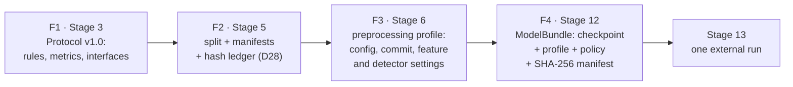

# Stage 3 — Experimental Protocol v1.0 (freeze F1)

| | |
|---|---|
| **Stage** | 3 — Experimental Protocol v1.0 (freeze F1) |
| **Owner** | Donia Mabrouk (lead; D26, Part A) |
| **Reviewer(s)** | Iheb Zemzemi, Malak Ben Salem, Khalil Dridi (D26: Stage 3 sign-off by all four) |
| **Status** | In review |
| **Date** | 2026-10-18 |
| **Related PRs** | #7 (`docs/stage3-repo-cleanup`: team of four, D26; Entry 18) · #8 (`docs/stage3-protocol-skeleton`, v0.1; Entry 19) · #10 (`docs/stage3-protocol-v1`, v1.0 = F1, signed by all four; Entry 21) · #16 (`docs/stage7-protocol-clarifications`, D29–D31; Entry 32) |

## 1. In one paragraph

The protocol is the rulebook of the experiment, written and frozen before any model exists. It fixes
how FoR is split, how audio is preprocessed, which models are trained and how one is chosen, which
metrics are reported, how the threshold and the "uncertain" band are set, how the single external
run on DEEP-VOICE works, and which degradations the robustness test uses. It also fixes the four
hand-over contracts between team members, so they can work in parallel. Because every rule is
written before the results exist, the results cannot bend the rules that judge them. Version 1.0,
signed by all four members on 2026-10-14, is freeze point F1; the full text is
[`docs/experimental_protocol.md`](../experimental_protocol.md), and this brief explains it.

## 2. Inputs → outputs

| | What | From / to | Path |
|---|---|---|---|
| In | Audit facts and decisions (D5, D9, D13, D14, D16–D20; H5, H6) | Stage 1 (Donia) | `docs/dataset_audit.md` |
| In | Scenario, threats T1–T7, claim limits | Stage 2 (Donia) | `docs/threat_model.md` |
| In | Stage 3 tasks, ownership, the four hand-overs, freeze points | Execution Plan v2.1 §5, §6, §7 Stage 3 | `docs/reference/Execution_Plan_v2.1.pdf` |
| In | Proposed defaults (one value per open item), accepted by all four on 2026-10-14 | Donia, with Claude (claude.ai); kept outside the repo (Entry 21) | not in the repo |
| Out | Protocol v1.0 = F1 (§0–§12) | Every later stage | `docs/experimental_protocol.md` |
| Out | Interfaces B→C, C→D, C→E, B→Stage 14 (all four D26 hand-overs) | Malak → Donia; Donia → Khalil; Donia → Iheb; Malak → Stage 14 | Protocol §11 |
| Out | H1–H4 registered; H5/H6 made operational | Stages 11, 13, 14, 15 | Protocol §1, §7, §9 |
| Out | D26 (team, parts, review rule) and D29–D31 (clarifications) | Register | `docs/decisions/README.md` |

## 3. How it works, step by step

1. **Team and split of work first** (PR #7): Khalil joined; D26 recorded the parts A–E, the review rule
   and the four hand-overs (Entry 18).
2. **Skeleton v0.1** (PR #8): sections 0–14, each with owner, reviewer and a "Must decide" checklist
   citing its source; nothing decided yet (Entry 19).
3. **Proposed defaults:** Donia drafted one proposed value per open item with Claude (claude.ai),
   each marked Fixed / Judgment / Team with its basis (Entry 21).
4. **Team acceptance:** all four accepted every row on 2026-10-14 in the team chat, so the protocol
   was written in one integrated PR instead of one PR per author (Entry 21).
5. **v1.0 = F1** (PR #10): written by Claude Code from the accepted defaults; each "Must decide" list
   became a "Decided" list; rules that are one value among several are marked "team choice,
   2026-10-14". Signed by all four (§13; Entry 21).
6. **Change control** (§12): what may still change, and how (section 7, Q7).
7. **Clarifications D29–D31** (PR #16, 2026-10-17): three gaps found while building the evaluation
   harness, decided before any Stage 7–11 data was seen; no rule changed (§14; Entry 32).

The four freeze points (§12; Execution Plan v2.1 §6). After each one, its content changes only
through a new decision:



## 4. Key decisions and why

- **D1** — protocol written after the audit and frozen before training: the rules come before the results.
- **D9** — validation split into val-A (training decisions) and val-B (threshold, calibration): no
  choice is fitted twice on the same data.
- **D11** — 3 seeds on the final CNN; bootstrap 95% CIs, clustered by source speaker on DEEP-VOICE.
- **D12** — threshold at the val-B EER point plus a fixed deferral policy (exact rule in §6).
- **D4** — the metric set, positive class = spoof: one result never rests on accuracy alone.
- **D17** — speech-window filter fixed before the external run (threshold ≥ 50% speech frames, §8).
- **D26** — owners, "consumer reviews producer", and the four interfaces fixed in Stage 3.
- **D29–D31** — baseline threshold rule, CNN search space and seeds, Stage 11 run once: gaps closed
  before any data was seen.

## 5. Evidence

- Sign-off: Donia (lead, author), Malak, Khalil, Iheb, all dated 2026-10-14, PR #10 [doc] — source:
  Protocol §13; Entry 21. PR #10 merge commit `d8391e1`, sign-off commit `7c6c07d` [verified: git log].
- At v1.0: `python -m pytest -q` → 15 passed; grep of the protocol for the governance-test patterns →
  no match [verified] — source: Entry 21.
- D29–D31 were decided before any Stage 7–11 data was seen [doc] — source: Entry 32; Protocol §14.
- Rules later enforced in code [verified: read in the code on this branch]:
  `select_bundle_seed()` returns the seed with the median val-A EER, lowest seed on a tie, and refuses
  an even number of seeds (`src/evaluation/seeds.py`); `fit_risk_policy()` takes the val-B EER point
  on calibrated p and the widest symmetric band whose deferral on the fit data is ≤ `target_deferral`
  (default 0.10) (`src/tuning/risk_fit.py`), using the single band rule `three_way_decisions()`
  (`src/risk/decisions.py`); `RISK_LEVELS` maps authentic / uncertain / synthetic to LOW / MEDIUM /
  HIGH (`src/risk/policy.py`); `RunRegistry.claim()` refuses a second claim for the same (dataset,
  split, model set) (`src/evaluation/run_registry.py`); `load_bundle()` checks each part's SHA-256
  against the manifest and the policy version (`src/bundle/bundle.py`).
- Those code paths are tested on synthetic data: `seeds`, `run_registry`, `risk`, `tuning` and
  `bundle` tests → `131 passed` on this branch (Python 3.14.7 local venv).
- F2 applied the protocol's split rules and is effective (D28; Entry 36).

## 6. Limitations

- Many values are "team choice, 2026-10-14": one defensible value among several, not derived from data
  (Protocol header). Examples: the 10% deferral, the ≥ 5-point H5/H6 thresholds, 2,000 bootstrap
  resamples, the robustness levels. The reasoning for each is in the defaults file, which is not in
  the repo (Entry 21); for most of them, the reason is not recorded in the repo.
- F1 deliberately leaves items to Stage 6 (silence detector, loudness normalization, resampler and
  invariance tolerance); they are frozen only in F3 (§12 change control (1)).
- Still open after F1: online handling of clips longer than 2 s (before Stage 17); DEEP-VOICE
  file-level decisions and the speaker-average undefined-value convention (before Stage 13); the
  governance allowlist for the external-run code (§8; Open items).
- The protocol was written in one integrated PR from the accepted defaults, not by each section
  author (Entry 21): the teach-back review is where each owner shows they can defend their sections.
- The C→E bundle check is not complete in code yet: the profile-version check waits for the F3
  profile format (Open items, Stage 12).
- 3 seeds give only a rough estimate of the seed-to-seed spread [hypothesis: statistical judgement,
  not measured].

## 7. Questions the professor may ask

1. **Q:** Why freeze the protocol before any model exists?
   **A:** So the results cannot shape the rules that judge them (Execution Plan v2.1 §7 Stage 3 "Goal";
   Protocol intro). D1 orders it after the audit and before training; hard rule 4 forbids training code
   before the freeze.
2. **Q:** Why split validation into val-A and val-B?
   **A:** val-A takes the training decisions (early stopping, CNN and SVM selection); val-B only fits the
   threshold, calibration and uncertain band, so these are not tuned on the data the model was chosen on
   (D9; §2, §4, §6). Possible because val-B has ≈ 665 clips per class ≥ 500 (D9).
3. **Q:** Why is DEEP-VOICE evaluated only once, and by someone who did not build the model?
   **A:** The generalization claim holds only if DEEP-VOICE never shapes the model, preprocessing or
   policy (ADR 0005; hard rule 1; SRS PC-05). Khalil runs it because "the person who trained the model
   never touches the external test" (Execution Plan v2.1 §5); all four review it (D26).
4. **Q:** How are the 3 seeds reported, and how is the bundle seed chosen?
   **A:** Seeds 0, 1, 2 on the final configuration (D11, D30); mean ± SD of EER and ROC-AUC on the FoR
   test; bootstrap CIs on the bundle seed, seed SD as a separate row. Bundle seed = median val-A EER,
   lower seed on a tie (§5; `select_bundle_seed()`).
5. **Q:** What is the uncertain band, and why at most 10% deferral?
   **A:** A symmetric zone around the val-B threshold on calibrated p; cases inside become "uncertain"
   (MEDIUM risk) and go to manual verification (§6; FR-05; threat model §9). 10% is a team choice
   (§6, D12 asks for a fixed deferral policy); why exactly 10% is not recorded in the repo.
6. **Q:** Which metrics do you report, and why never accuracy alone and no t-DCF?
   **A:** D4 in full: accuracy, precision, recall, F1, EER, ROC-AUC, 3-way confusion matrix, coverage /
   deferral, class counts, FPR / FNR, 95% CIs (§5). DEEP-VOICE windows are 87.5% FAKE, so "always fake"
   already scores 87.5% accuracy. t-DCF is ASVspoof-specific, which we do not use (SRS §2.5, PC-06).
7. **Q:** What can still change after the freeze, and what cannot?
   **A:** Can: the Stage 6 items left open by design, frozen in F3; other changes only through a new
   decision logged before the affected data is seen (e.g. D29–D31). Cannot: anything after its results
   are seen; extra analyses are labelled exploratory (§12 change control; interfaces: D26).
8. **Q:** What are the four interfaces between parts, and why were they fixed in Stage 3?
   **A:** B→C manifests + preprocessing I/O; C→D bundle, `score(audio)` and the stored-score CSV; C→E API
   response + bundle loading with hash check; B→Stage 14 degradations through the same profile (§11;
   D26). Fixed early so owners work in parallel: "only if the hand-overs are written down first" (v2.1 §5).

## 8. How to verify or re-run it

The protocol is a document; checking it means checking its sign-off, its frozen state, and the code
that enforces its rules. No data or tokens needed:

```bash
git show --stat d8391e1                     # PR #10 merge: Protocol v1.0 (F1)
git log --oneline -- docs/experimental_protocol.md   # every change after F1 must match a §14 row
python -m pytest -q tests/evaluation/test_seeds.py tests/evaluation/test_run_registry.py \
    tests/risk tests/tuning tests/bundle    # bundle seed, run-once, band rule, risk levels, bundle hashes
python -m pytest -q tests/governance        # DEEP-VOICE guard
```

Expected: the only protocol commits after `7c6c07d` belong to PR #16 (the D29–D31 §14 row); the rule
tests printed `131 passed` and the governance test `3 passed` on this branch (Python 3.14.7 local
venv). The Mermaid diagram above renders on GitHub.
