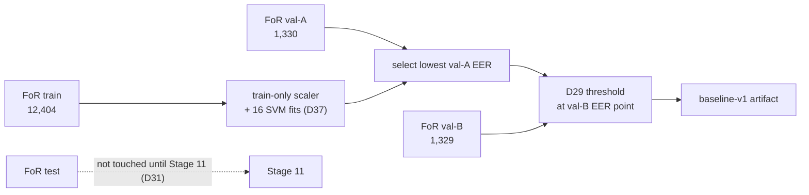

# Stage 7 — Evaluation harness + MFCC/SVM baseline

| | |
|---|---|
| **Stage** | 7 — Evaluation harness + MFCC/SVM baseline |
| **Owner** | Donia Mabrouk (D26, Part C) |
| **Reviewer(s)** | Khalil Dridi and Iheb Zemzemi (D26: consumers of Part C) |
| **Status** | Accepted (closeout PR docs/stage7-closeout) |
| **Date** | 2026-10-24 |
| **Related PRs** | #13 (evaluation harness), #16 (D29–D31), #30 (D37), #31 (baseline code), #39 (MFCC cache), #41 (baseline run code and notebook), and the results branch `docs/stage7-baseline-results` |

## 1. In one paragraph

Stage 7 builds two things. First, one shared evaluation harness (`src/evaluation/`) that computes
every D4 metric the same way for every model and every split: EER and ROC-AUC, decision metrics at a
threshold, three-way decisions with coverage, bootstrap confidence intervals and the seed summary.
Second, an evaluation-only reference model: an RBF-SVM on 40 MFCC values (mean and standard
deviation of 20 coefficients), fitted on FoR train, tuned on val-A and thresholded on val-B. The
pipeline needs both so that numbers are comparable across stages, so that the CNN has a simple
reference point, and so that H1 (CNN better than the baseline on the FoR test) and RQ2 (CNN vs
baseline, in-domain and externally) can be answered at all. The baseline is never deployed (D7).

## 2. Inputs → outputs

| | What | From / to | Path |
|---|---|---|---|
| In | F2 FoR manifest (17,721 rows, D28) | Stage 5 (Malak) | `data/manifests/for2sec_frozen_manifest.csv` |
| In | F3 preprocessing profile, 40-value MFCC vector (D39) | Stage 6 (Malak); B→C hand-over (D26) | `configs/preprocessing.yaml`, `src/preprocessing/` |
| In | Baseline grid, scaling and score (D37) | Stage 7 (Donia) | `configs/baseline.yaml` |
| Out | Evaluation harness | All later stages (8–16) | `src/evaluation/`; [evaluation_harness.md](../evaluation_harness.md) |
| Out | Baseline artifact `baseline-v1` (hash in `run_report.json`) | Stage 11 (FoR test); Stage 13 under D36 (Khalil); Stage 14 if D41 is approved (Malak) | Drive `checkpoints/baseline/baseline-v1/` (not in Git) |
| Out | Evidence and validation results | Reviewers, Stage 19 report | `docs/audit_evidence/stage7_baseline/`, [results/baseline.md](../results/baseline.md) |

The FoR test split and DEEP-VOICE are not inputs to this stage.

## 3. How it works, step by step



1. **Harness** (PR #13): EER with a documented threshold rule, ROC-AUC, decision metrics,
   three-way decisions, clustered bootstrap CIs and seed summary, all on synthetic tests
   ([evaluation_harness.md](../evaluation_harness.md)).
2. **Scaler and scorer** (B1, PR #31): per-feature mean and std fitted on train only and stored in
   the artifact; a NumPy RBF scorer equal to scikit-learn's `decision_function`; a non-pickle,
   byte-deterministic artifact ([baseline.md](../baseline.md)).
3. **Selection** (B2): 16 configurations, C ∈ {0.1, 1, 10, 100} × γ ∈ {0.001, 0.01, 0.025, 0.1},
   each trained on train and scored on val-A; lowest val-A EER wins; ties go to smaller C, then
   smaller γ (D37).
4. **Threshold** (B2): the selected model scores val-B; the threshold is the val-B EER point of that
   score, forced binary (D29).
5. **MFCC cache** (PR #39): the 40-value vectors of train, val-A and val-B, computed once with F3 and
   bound to the F2 hash and F3 fingerprint; the test split is refused in code before any file is
   read ([feature_cache.md](../feature_cache.md)).
6. **Run orchestrator** (PR #41): loads the three caches, runs selection and threshold, saves the
   artifact and writes four reports with full provenance (commit, environment, all hashes)
   ([baseline_run.md](../baseline_run.md)).
7. **Colab run** (2026-10-24, Donia): from merge commit `297c352` on a clean checkout; caches and fit
   each run twice and compared byte for byte (`notebooks/03_stage7_baseline.ipynb`).
8. **Evidence check**: the committed JSON files are re-hashed against `determinism.json`, and the
   cache hashes are compared across `run_report.json` and `determinism.json` (Entry 74).

## 4. Key decisions and why

- **D7** — baseline = MFCC (mean + std) + RBF-SVM, evaluation only: a simple, well-known reference,
  with no risk policy and no deployment.
- **D9** — val-A for model decisions, val-B for the threshold: the threshold is not fitted on the
  data that chose the model.
- **D29** — own threshold at the val-B EER point, forced binary, no calibration or uncertain band:
  same rule and data as the CNN, so the comparison is fair.
- **D31** — the FoR test split runs once at Stage 11 under a run registry: Stage 7 code has no test
  path, so no unrecorded test pass is possible.
- **D37** — train-only standardization, the 16-point grid, the tie rule and `decision_function` as
  the score, all fixed before any val-A result existed.
- **D40** — no W&B for the baseline: one deterministic fit, whose full provenance is committed as
  JSON reports instead.
- **Subgroup breakdown** — REAL vs FAKE_mp3 and REAL vs FAKE_other EER on val-A and val-B,
  pre-declared on 2026-10-24 before the run and used for no decision ([baseline_run.md](../baseline_run.md) (d)).

## 5. Evidence

All under `docs/audit_evidence/stage7_baseline/` unless stated; details in
[results/baseline.md](../results/baseline.md). Validation results only, not test results.

- [verified] Selected **C 10, γ 0.1**; exact val-A EER tie with C 100, γ 0.1, broken by the D37
  smaller-C rule; val-A EER **≈ 0.149%** (0.0014925) — source: `selection_report.json`.
- [verified] D29 threshold **0.13285804202427817**; val-B EER **0.0** on **1,329** clips
  (660 bonafide, 669 spoof) — source: `threshold_report.json`.
- [verified] Cache rows train / val-A / val-B = **12,404 / 1,330 / 1,329**, equal to the Stage 4
  split sizes; F2 hash = D28; profile config hash and fingerprint = D39 — source: `train.json`,
  `val-A.json`, `val-B.json`, `run_report.json`.
- [verified] `artifact_sha256` **`42cc4d53a7cd881f56e4fa54fcf4797de8885b404d0a2b31c293555c868df10a`**;
  code commit `297c352c91bfc9daafa2943ba04154194aa33248`; Python 3.13.16, scikit-learn 1.9.1 —
  source: `run_report.json`.
- [verified] Caches and fit each ran twice with byte-identical outputs (`caches_byte_identical`,
  `runs_byte_identical` true); all 11 committed-file and cross-file hash checks pass — source:
  `determinism.json`, Entry 74.
- [verified] Descriptive subgroups: val-B EER 0.0 for both FAKE subgroups; val-A 0.0 (FAKE_mp3)
  and 0.30% (FAKE_other) — source: `subgroup_report.json`.
- [verified] `python -m pytest -q` → **445 passed** (local `.venv`); synthetic data only — Entries
  73–74.

## 6. Limitations

- [hypothesis] **In-domain upper bound.** Train and validation share FoR's TTS generators and
  probably speakers (no speaker metadata [verified absence]; the 0.95 grouping removes only
  near-duplicates), so these numbers overstate performance on new data.
- [hypothesis] **Possible shortcuts.** FAKE clips are band-limited (median 99%-energy bandwidth
  ≈ 3.3 kHz vs ≈ 5.1 kHz REAL, `dataset_audit.md` §3.2) and differ slightly in loudness and silence
  (D39). MFCC summaries can capture all three (H6, H7).
- [derived from the EER method] **Threshold at the spoof edge.** With val-B EER exactly 0, the
  returned threshold is the lowest val-B spoof score, not the middle of the gap; on new data,
  misses are more likely than false alarms [hypothesis].
- [verified] **Grid edge.** The selected γ 0.1 is the largest γ in the grid; val-A EER is flat
  (≈ 0.15%) across several configurations. Nothing outside the grid was tried.
- [verified] **Resolution.** About 1,330 clips per validation set cannot separate error rates below
  ≈ 0.1%; one clip is ≈ 0.15% of a class.
- [hypothesis] **H1 ceiling.** With the baseline near 0% EER in-domain, H1 may not be able to show
  a CNN advantage on the FoR test. H1 stays unchanged and will be reported as pre-registered.

## 7. Questions the professor may ask

1. **Q:** Why build a baseline at all if it is evaluation-only?
   **A:** It gives the CNN a simple, well-known reference, so "the CNN is good" has a meaning (H1,
   RQ2). It is compared in-domain and in the single external run (D7, D36), but never deployed.
2. **Q:** Why fit the scaler on train only, and why store it inside the artifact?
   **A:** Fitting on train only keeps val-A, val-B, test and external data out of the fit (D37).
   Storing it in the artifact means the same scaling is applied everywhere and is covered by
   `artifact_sha256` ([baseline.md](../baseline.md) (c)).
3. **Q:** How was the configuration chosen, and why C 10 rather than C 100 at the same val-A EER?
   **A:** All 16 grid points were fitted on train and ranked by val-A EER (D37). C 10 and C 100
   (both γ 0.1) tie exactly; the pre-declared tie rule takes the smaller C (`selection_report.json`).
4. **Q:** Why is the threshold set on val-B and not on val-A?
   **A:** val-A already chose the model; reusing it for the threshold would fit two choices to the
   same data and make the threshold optimistic. D9 gives val-B to the threshold, as for the CNN (D29).
5. **Q:** Why use decision_function scores and no calibration or uncertain band for the baseline?
   **A:** The baseline is evaluation-only, so it needs a score for EER/ROC-AUC and one forced-binary
   threshold, not a risk policy (D29). `decision_function` is the score the artifact and Stage 13
   produce, so threshold and stored scores share one scale (D37).
6. **Q:** Your val-B EER is 0.0. Does that mean the problem is solved?
   **A:** No. It is in-domain validation with shared generators and probably speakers, and possible
   bandwidth, loudness and silence shortcuts [hypothesis]. The external run (Stage 13) is the real
   test ([results/baseline.md](../results/baseline.md) §6).
7. **Q:** How do you know the run is reproducible and the committed evidence untouched?
   **A:** The notebook ran caches and fit twice from a clean exact commit with byte-identical
   outputs. Each committed file's SHA-256 matches `determinism.json`, and every input hash (F2, F3,
   config, caches) is recorded in `run_report.json` (Entry 74).
8. **Q:** How is the FoR test split kept out of Stage 7, by rule or by code?
   **A:** By code. `mfcc_cache` refuses the test split before reading any file, and the run
   orchestrator has no split argument and no test path; tests check both (`feature_cache.md` (a),
   `baseline_run.md` (a)). Stage 11's run registry then allows one test run (D31).

## 8. How to verify or re-run it

Local tests (synthetic data, no dataset needed):

```bash
python -m pytest -q tests/evaluation/ tests/models/ tests/tuning/ tests/features/
```

Re-check the committed evidence against `determinism.json` (prints `True` for every line):

```python
import hashlib, json
from pathlib import Path
d = Path("docs/audit_evidence/stage7_baseline")
det = json.loads((d / "determinism.json").read_text())
run = json.loads((d / "run_report.json").read_text())
h = lambda n: hashlib.sha256((d / n).read_bytes()).hexdigest()
for n in ["train.json", "val-A.json", "val-B.json"]:
    print(n, h(n) == det["cache_sha256"][n])
for n in ["selection_report.json", "threshold_report.json", "run_report.json", "subgroup_report.json"]:
    print(n, h(n) == det["run_sha256"][n])
for s in ["train", "val-A", "val-B"]:
    print(s, run["caches"][s]["npz_sha256"] == det["cache_sha256"][f"{s}.npz"])
print("commit", det["code_commit"] == run["code_commit"])
```

The four test folders gave 295 passed on main after PR #42. The full run is
[`notebooks/03_stage7_baseline.ipynb`](../../notebooks/03_stage7_baseline.ipynb) (run copy, view-only:
link in [results/baseline.md](../results/baseline.md) §1). It needs the pinned FoR archive in Drive
and a Colab runtime; output folders must be new, and committed evidence is never overwritten.
