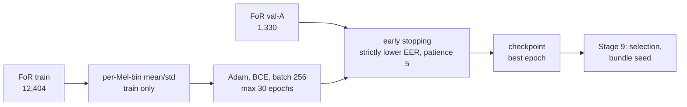

# Stage 8 — CNN training

| | |
|---|---|
| **Stage** | 8 — CNN training (with Stage 9, model selection: [stage09-model-selection.md](stage09-model-selection.md)) |
| **Owner** | Donia Mabrouk (D26, Part C) |
| **Reviewer(s)** | Khalil Dridi and Iheb Zemzemi (D26: consumers of Part C) |
| **Status** | Draft, pending teach-back (D32) |
| **Date** | 2026-10-26 |
| **Related PRs** | #44 (D42), #45 (log-Mel cache), #47 (CNN foundations), #48 (training loop, W&B, search), #49 (notebook 04), #50 (tests shadowing fix), and the results branch `docs/stage8-cnn-selection` |

## 1. In one paragraph

Stage 8 trains the project's deployed model: one small CNN that reads a 2-second clip as a log-Mel
spectrogram (64 Mel bins × 197 frames) and outputs one score, higher meaning more likely
synthetic. It is trained on FoR train only, with early stopping on val-A, and every training run
is recorded with full provenance (code commit, environment, every input hash) and logged to W&B.
The official run on Colab trained the four D30 search configurations and the two extra seeds of
the chosen one, and saved three non-pickle checkpoints to Drive. Choosing the configuration and
the bundle seed is Stage 9, done in the same run by pre-declared rules. The pipeline needs this
stage because every later stage (risk policy, test, external run, API) uses the checkpoint it
produces.

## 2. Inputs → outputs

| | What | From / to | Path |
|---|---|---|---|
| In | F2 FoR manifest (17,721 rows, D28) | Stage 5 (Malak) | `data/manifests/for2sec_frozen_manifest.csv` |
| In | F3 preprocessing profile, log-Mel (1, 64, 197) (D39) | Stage 6 (Malak); B→C hand-over (D26) | `configs/preprocessing.yaml`, `src/preprocessing/` |
| In | CNN design and training rules (D30, D42) | Stage 8 (Donia) | `configs/cnn.yaml` |
| Out | Checkpoints `cnn-v1` seeds 0–2 (bundle seed 0) | Stage 10 (risk policy), Stage 12 (ModelBundle), Stage 13 (Khalil) | Drive `checkpoints/cnn/cnn-v1/seed_{0,1,2}/` (not in Git) |
| Out | Run evidence and validation results | Reviewers, Stage 19 report | `docs/audit_evidence/stage8_cnn/`, [results/cnn_selection.md](../results/cnn_selection.md) |

val-B, the FoR test split and DEEP-VOICE are not inputs to this stage.

## 3. How it works, step by step



1. **Log-Mel cache** (PR #45): the F3 log-Mel of every train and val-A clip, computed once, bound
   to the F2 hash and F3 fingerprint; the test split is refused in code
   ([logmel_cache.md](../logmel_cache.md)).
2. **Model and checkpoint** (PR #47): the D42 CNN (3 or 4 blocks of conv 3×3 → BatchNorm → ReLU →
   max-pool, global average pooling, dropout 0.3, one logit); per-Mel-bin standardization fitted
   on train only and stored in the checkpoint; a safetensors + strict-JSON checkpoint, no pickle
   ([cnn.md](../cnn.md)).
3. **Training loop** (PR #48): one shuffled pass over train per epoch, val-A EER and ROC-AUC after
   each epoch; an epoch improves only if its val-A EER is strictly lower; the best epoch is
   restored; stop after 5 non-improving epochs or 30 epochs ([cnn_training.md](../cnn_training.md)).
4. **W&B** (PR #48): an allow-list logger sends only the run config, per-epoch train loss, val-A
   EER, val-A ROC-AUC and epoch time, and the final summary; any key naming val-B, test or
   external data is refused (D40).
5. **Notebook 04** (PR #49): mounts Drive, checks out the exact commit on a clean clone, asserts
   Python 3.13 and torch 2.11.0, runs the full test suite, builds the caches twice and compares
   them, runs the search, exports to Drive and re-verifies every hash after a remount.
6. **First attempt** (2026-10-24): stopped at the pytest cell, because a `tests` package installed
   on Colab shadowed the repo's `tests/`; nothing ran after it, no result seen. Fixed in the repo
   (PR #50, Entry 82), not in the notebook, so the official run equals the reviewed commit.
7. **Official run** (2026-10-26, Donia): from `9be2f25`; 717 tests passed; 6 training runs; 3
   checkpoints and 3 reports exported and verified.
8. **Evidence check** (PR D section 0): every exported hash, the `checkpoint_sha256` values, the
   provenance hashes and the selection were recomputed locally from the Drive download
   ([evidence README](../audit_evidence/stage8_cnn/README.md)).

## 4. Key decisions and why

- **D42** — CNN design, train-only per-Mel-bin standardization, no per-clip normalization, strict
  early stopping, non-pickle checkpoint, determinism settings: all fixed before any CNN code or
  training, so nothing is designed against validation results.
- **D30** — max 30 epochs, patience 5, Adam, batch 256 from the Stage 6 benchmark: a small,
  pre-declared training budget.
- **D9** — only val-A is used in Stages 8–9; val-B stays unseen until Stage 10 fits the risk
  policy.
- **D40** — W&B from Stage 8, allow-listed metrics only: every CNN run is tracked, and no other
  split's numbers can leak into the logs.
- **D11** — three seeds of the chosen configuration, so seed variation is visible.
- **D2** — the checkpoint becomes part of the ModelBundle, fitted on FoR only and frozen in Stage
  12 before the external run.

## 5. Evidence

All under `docs/audit_evidence/stage8_cnn/` unless stated; details in
[results/cnn_selection.md](../results/cnn_selection.md). Validation results only, not test results.

- [verified] Run from code commit `9be2f2545520432db08a0d083a06a668cd84103a`; Python 3.13.16,
  torch 2.11.0+cu130, Tesla T4 — source: `run_report.json`.
- [verified] Notebook test cell: 717 passed, 0 failures / errors / skipped — source:
  `stage8_export_manifest.json` `pytest_counts`.
- [verified] Seeds 0, 1, 2 of b4 / lr 1e-3: best val-A EER 0.0 at epochs 10, 13, 9, stopped at 15,
  18, 14 (patience 5) — source: `selection_report.json`.
- [verified] Peak GPU memory 1,893,388,288–1,894,575,616 bytes (1.76 GiB) per run; about 5 s per
  epoch — source: `run_report.json`, `search_report.json`.
- [verified] All 9 exported files match the manifest (SHA-256 and size); `checkpoint_sha256`
  recomputed for 3/3 seeds — source: evidence README "Verification".
- [verified] Caches built twice in the run, byte-identical; 6 W&B runs, allow-listed keys only —
  source: notebook cell 7 and 9 output, evidence README.

## 6. Limitations

- [verified] **Single runs.** Each configuration and seed was trained once; byte-identical GPU
  re-runs are not promised (D42) and were not measured.
- [hypothesis] **Epoch cap.** The 3-block runs had their best epochs at 27 and 26 and stopped at
  the 30-epoch cap, so the cap may have limited them. D30 fixes the cap; nothing changes.
- [verified] **Validation only.** Every number is on val-A, the split used for early stopping and
  selection, so it is optimistic.
- [hypothesis] **Possible shortcuts.** EER 0 on all three seeds is consistent with in-domain cues
  (bandwidth, loudness, silence) described in Stage 7. Bandwidth and silence are tested later by
  H6 and H7 (MP3 traces by H5); no pre-registered test targets loudness
  ([results/cnn_selection.md](../results/cnn_selection.md) §8).
- [verified] **Checkpoints on Drive only.** Their integrity rests on the recorded hashes
  (`run_report.json` `checkpoint_sha256`); `load_checkpoint(..., expected_sha256=...)` refuses a
  checkpoint whose bytes differ. The bundle seed's checkpoint is frozen into F4 at Stage 12
  (Protocol §12).

## 7. Questions the professor may ask

1. **Q:** Why a small CNN on log-Mel spectrograms and not a pretrained model like wav2vec2?
   **A:** The scope is locked to one CNN on log-Mel (AGENTS.md rule 3); pretrained models,
   ensembles and other features are future work. The research question is cross-dataset
   generalization of this pipeline, not the strongest possible detector.
2. **Q:** Why are the normalization statistics computed on train only and stored in the checkpoint?
   **A:** So no validation, test or external data influences the model (D42), and so every split,
   the external run and the API apply exactly the same scaling.
3. **Q:** Why no per-clip normalization, which is common practice?
   **A:** D42 records the reason: per-clip normalization "would remove level information after the
   baseline showed a loudness cue, which would mean designing against validation results and
   blurring H6/H7; shortcuts are tested by H5–H7 and D41" (`docs/decisions/README.md`, D42). The
   measured loudness separability is D39's train-only FAKE-vs-REAL RMS AUC, 0.698602. So level
   information is kept, decided before training, and shortcuts are to be tested rather than designed
   out. PR D found one gap in that plan: no pre-registered test targets loudness directly (H6
   bandwidth, H7 silence, H5 MP3 traces); a D43 proposal will address it (Entry 86).
4. **Q:** How does early stopping work, and which epoch is saved?
   **A:** After each epoch, val-A EER is computed; only a strictly lower EER counts as improvement;
   after 5 epochs without one (or 30 epochs) training stops, and the best epoch's weights, the
   earliest on ties, are saved (D42).
5. **Q:** Why does the first Colab attempt matter if it produced nothing?
   **A:** It stopped at the tests before any training, so no result was seen and nothing could be
   chosen from it. The fix went into the repo (PR #50), so the official run equals a reviewed
   commit (Entry 82).
6. **Q:** How do you know the checkpoints on Drive are the ones the run produced?
   **A:** The run wrote a manifest with each file's SHA-256 and re-verified Drive after a remount;
   the download was re-hashed locally, and each checkpoint's `checkpoint_sha256` was recomputed and
   matched `run_report.json`.
7. **Q:** Is the training reproducible?
   **A:** Seeds and deterministic settings are fixed and recorded (D42), and the caches were
   byte-identical across two builds. Byte-identical GPU training is not promised and was not
   tested: each run was made once.
8. **Q:** What does W&B see?
   **A:** Only the run config and the allow-listed train/val-A metrics; the logger refuses any key
   naming val-B, test or external data, and no audio or per-clip data is logged (D40).

## 8. How to verify or re-run it

Local tests (synthetic data, no dataset needed):

```bash
python -m pytest -q tests/features/test_logmel_cache.py tests/models/ tests/training/ tests/tuning/test_cnn_search.py
```

Re-check the committed evidence: follow the evidence
[README](../audit_evidence/stage8_cnn/README.md) "Verification" (re-hash the four committed files
against its table; with the Drive checkpoints, recompute `checkpoint_sha256` with
`src.models.cnn_checkpoint.checkpoint_sha256`). The full run is
[`notebooks/04_stage8_cnn.ipynb`](../../notebooks/04_stage8_cnn.ipynb) with `COMMIT` set to the
approved merge commit; it needs the pinned FoR archive in Drive, a GPU runtime and the W&B key in
Colab secrets. Output folders must be new; evidence on Drive is never overwritten.
