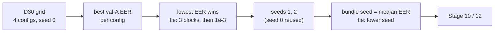

# Stage 9 — Model selection

| | |
|---|---|
| **Stage** | 9 — Model selection (FoR val-A) (with Stage 8, training: [stage08-cnn-training.md](stage08-cnn-training.md)) |
| **Owner** | Donia Mabrouk (D26, Part C) |
| **Reviewer(s)** | Khalil Dridi and Iheb Zemzemi (D26: consumers of Part C) |
| **Status** | Accepted (closeout PR docs/stage8-9-closeout) |
| **Date** | 2026-10-26 |
| **Related PRs** | #16 (D30), #48 (search and selection code), #49 (notebook 04), #50 (tests shadowing fix), and the results branch `docs/stage8-cnn-selection` |

## 1. In one paragraph

Stage 9 decides which CNN goes forward. A small grid fixed before training (D30: 3 or 4 conv
blocks × learning rate 1e-3 or 3e-4) is trained with seed 0, and the configuration with the
lowest val-A EER wins, with a pre-declared tie rule. The winner is then trained with seeds 1 and
2 as well, and one of the three seeds, the one with the median val-A EER, becomes the bundle seed
whose checkpoint the ModelBundle will use. Both choices ran inside the same Colab run as Stage 8,
by code, so no choice was made by hand after seeing results. The outcome: **4 blocks, learning
rate 1e-3, bundle seed 0**, with val-A EER 0 for all three seeds, a result that is validation
only and too good to take at face value.

## 2. Inputs → outputs

| | What | From / to | Path |
|---|---|---|---|
| In | The 4 search runs and 3 seed runs with per-epoch val-A history | Stage 8 (Donia), same run | `search_report.json`, `selection_report.json` |
| In | Grid, tie rule, seeds (D30, D11) | Stage 8 (Donia) | `configs/cnn.yaml` |
| Out | Selected configuration (b4, lr 1e-3) and bundle seed 0 | Stage 10 (risk policy on val-B), Stage 12 (ModelBundle) | `docs/audit_evidence/stage8_cnn/selection_report.json` |
| Out | Validation results and interpretation | Reviewers, Stage 19 report | [results/cnn_selection.md](../results/cnn_selection.md) |

val-B, the FoR test split and DEEP-VOICE are not inputs to this stage.

## 3. How it works, step by step



1. **Search** (Stage 8): the 4 configurations train with seed 0; each run's score is its best
   val-A EER under the D42 early-stopping rule.
2. **Selection**: the lowest best val-A EER wins. Ties would go to 3 blocks before 4, then
   learning rate 1e-3 before 3e-4 (`select_configuration`, D30).
3. **Seeds**: the winner trains with seeds 1 and 2; seed 0 reuses the search run unchanged (D30).
4. **Bundle seed**: the seed with the median val-A EER; if several seeds share the median, the
   lowest seed (`select_bundle_seed`, D11, Protocol §5).
5. **Reports**: `selection_report.json` records the selected configuration, whether the tie rule
   decided it, the tied rows, every seed's history and the bundle seed; `run_report.json` records
   each seed's `checkpoint_sha256`.
6. **Recomputation** (PR D section 0): selection, stopping and bundle seed recomputed from the
   per-epoch histories, not from the summary fields; all equal the reports.

## 4. Key decisions and why

- **D30** — the 4-point grid, seed 0 for the search, the tie rule, the reuse of the seed-0 run:
  a real but small selection, declared before any result, with nothing added afterwards.
- **D9** — selection uses val-A only, so val-B stays independent for the risk policy (Stage 10).
- **D11** — three seeds of the final configuration and the median rule for the bundle seed: seed
  variation is reported, and the bundle is a typical seed, not the luckiest.
- **D42** — strictly-lower early stopping with the earliest epoch on ties: the score of each run
  is well defined.
- **D2** — the selected checkpoint joins the ModelBundle, frozen in Stage 12 before the external
  run.

## 5. Evidence

All under `docs/audit_evidence/stage8_cnn/`; details in
[results/cnn_selection.md](../results/cnn_selection.md). Validation results only, not test results.

- [verified] Search, best val-A EER: b3 / 1e-3 0.152% (1 of 660 clips), b3 / 3e-4 0.597% (4 of
  670), **b4 / 1e-3 0.0**, b4 / 3e-4 0.152% (1 of 660) — source: `search_report.json`.
- [verified] Selected b4 / lr 1e-3; unique minimum, tie rule not needed (`tie_rule_decided`
  false) — source: `selection_report.json`.
- [verified] Seeds 0, 1, 2: val-A EER 0.0, ROC-AUC 1.000000 at the best epoch; bundle seed 0 —
  source: `selection_report.json`.
- [verified] val-A has 660 bonafide and 670 spoof clips; one clip = 1/660 or 1/670; the
  configurations differ by 0–4 clips — source: F2 manifest, `run_report.json`.
- [verified] Selection and bundle seed recomputed from the histories = the reports — source:
  evidence README "Verification".
- [inference] Baseline-v1's val-A EER ≈ 1/670, one clip from the CNN's 0: not a claimed
  improvement — source: [results/baseline.md](../results/baseline.md) §3.

## 6. Limitations

- [verified] **Resolution.** val-A cannot separate error rates below about 0.15%; the selection
  rests on differences of 0–4 clips, and the three seeds cannot be told apart at all.
- [verified] **Bundle seed by tie-break.** All three seeds have EER 0, so the median rule's
  tie-break chose seed 0; it is not "the median performer" in any measurable sense.
- [verified] **Selected on val-A.** These EERs are on the split that chose the model and the
  epoch, so they are optimistic.
- [hypothesis] **Too good.** EER 0 is consistent with in-domain shortcuts (bandwidth, loudness,
  silence). H6 and H7 test bandwidth and silence (H5: MP3 traces); no pre-registered test targets
  loudness ([results/cnn_selection.md](../results/cnn_selection.md) §8).
- [hypothesis] **Cap effect.** The 3-block runs reached their best at epochs 27 and 26 under the
  30-epoch cap; a longer budget might have changed their EER, but D30 fixes the cap.

## 7. Questions the professor may ask

1. **Q:** How was the final CNN chosen?
   **A:** Four configurations fixed before training (D30) were trained with seed 0 and ranked by
   best val-A EER; 4 blocks at learning rate 1e-3 had the unique lowest value, 0
   (`selection_report.json`).
2. **Q:** All three seeds have EER 0. How can you pick a "median" seed?
   **A:** The rule is the median EER, ties to the lower seed (D11). With three equal values all
   tie, so seed 0 was chosen by the tie-break. That is the pre-declared rule, applied as written.
3. **Q:** Is the CNN better than the baseline?
   **A:** Not on this evidence. On val-A the difference is one clip (baseline ≈ 1/670), both
   selected on val-A. The pre-registered comparisons are H1 on the FoR test (Stage 11) and D36
   externally (Stage 13).
4. **Q:** EER 0 sounds perfect. Should we trust it?
   **A:** No. It is in-domain validation on the selection split, with possible bandwidth,
   loudness and silence shortcuts [hypothesis]; AGENTS.md says to suspect shortcuts first. The
   external run is the real test.
5. **Q:** Why not use val-B too, to get a better estimate?
   **A:** val-B is reserved for the risk policy and calibration (D9, Stage 10); using it for
   selection would leave no independent data for the threshold.
6. **Q:** The 3-block runs were still improving at epoch 30. Is the selection unfair to them?
   **A:** Possibly [hypothesis]. But the cap, the grid and the rule were declared before training
   (D30), and changing them after seeing results would be selection on val-A. The selection
   stands.
7. **Q:** How do you know the reported selection follows the rules?
   **A:** It was recomputed from the per-epoch histories, not taken from the summary fields:
   best epochs, stopping points, the selected configuration and the bundle seed all match.

## 8. How to verify or re-run it

Local tests (synthetic data, no dataset needed):

```bash
python -m pytest -q tests/tuning/test_cnn_search.py tests/training/test_train_cnn.py tests/evaluation/
```

To re-check the committed selection, recompute it from `search_report.json` and
`selection_report.json`: for each run, the first epoch with the minimum `val_a_eer` is its best
epoch; the lowest best EER wins (ties: fewer blocks, then the higher learning rate); the bundle
seed is the lowest seed among those at the median EER. The official run is the Stage 8 notebook
([stage08-cnn-training.md](stage08-cnn-training.md) §8).
