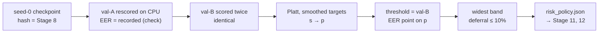

# Stage 10 — Risk policy and calibration

| | |
|---|---|
| **Stage** | 10 — Risk policy + calibration fit (FoR val-B) |
| **Owner** | Donia Mabrouk (D26, Part C) |
| **Reviewer(s)** | Khalil Dridi and Iheb Zemzemi (Protocol v1.0 §6; D26: consumers of Part C) |
| **Status** | Draft — pending D32 teach-back |
| **Date** | 2026-10-28 |
| **Related PRs** | #17 (R1–R2 code), #55 (D44), #56 (D44 approval record), #57 (D45), #58 (runner), #59 (notebook 05), #60 (evidence and results) |

## 1. In one paragraph

Stage 10 turns the CNN's raw score into the answer the system reports: authentic, synthetic or
uncertain, with a confidence and a LOW/MEDIUM/HIGH risk level. Three things are fitted on FoR val-B
only, for the bundle-seed CNN (seed 0): a Platt calibration that maps the raw score `s` to a
probability `p = P(spoof)`, an operating threshold at the val-B EER point on `p`, and a symmetric
uncertain band around it, as wide as possible while deferring at most 10% of val-B. Every rule was
fixed before any val-B score existed (Protocol §6, D12, D44, D45), and the official run on Colab
applied them by code, once. The outcome is the policy file `risk-v1`, which Stage 12 freezes into
the ModelBundle (F4) before the external run. These are validation values on the split the policy
was fitted on, not test results.

## 2. Inputs → outputs

| | What | From / to | Path |
|---|---|---|---|
| In | Bundle-seed checkpoint `cnn-v1` seed 0, and the Stage 8 evidence that anchors it (`checkpoint_sha256`, bundle seed) | Stage 8–9 (Donia) | Drive `checkpoints/cnn/cnn-v1/seed_0/`; `docs/audit_evidence/stage8_cnn/` |
| In | F2 FoR manifest (D28) | Stage 5 (Malak) | `data/manifests/for2sec_frozen_manifest.csv` |
| In | F3 preprocessing profile, log-Mel (D39) | Stage 6 (Malak) | `configs/preprocessing.yaml`, `src/preprocessing/` |
| In | FoR val-A (1,330 clips), **verification only**: re-scored to check the checkpoint, nothing fitted | Stage 4–5 split | log-Mel cache built in notebook 05 |
| In | FoR val-B (1,329 clips): the fit data | Stage 4–5 split | log-Mel cache built in notebook 05 |
| Out | `risk_policy.json` (`risk-v1`): Platt `a`, `b`, threshold, `half_width`, deferral | Stage 11 (FoR test, decision-level metrics), Stage 12 (F4 freeze), then Stage 13 (Khalil) and Stage 17–18 (Iheb) through the bundle | `docs/audit_evidence/stage10_risk/risk_policy.json`; Drive `checkpoints/risk/risk-v1/` |
| Out | `run_report.json`, `diagnostics_report.json`, `stage10_export_manifest.json` | Reviewers, Stage 19 report | `docs/audit_evidence/stage10_risk/` |
| Out | `val_b_scores.npz` (per-clip raw score and `p`) | Audit, bound to the reports by its hash; **Drive only** (data, AGENTS.md rule 7) | Drive `checkpoints/risk/risk-v1/` |
| Out | Validation results and interpretation | Reviewers, Stage 19 report | [results/risk_policy_fit.md](../results/risk_policy_fit.md) |

The FoR train split, the FoR test split and DEEP-VOICE are not inputs to this stage.

## 3. How it works, step by step



1. **R1–R2 code** (PR #17, Entry 33, 2026-10-17): the band rule moved into the core `src/risk`
   (so the API and the research code share one rule); Platt calibration with smoothed targets,
   fitted by Newton's method (`src/risk/calibration.py`); the fit in `src/tuning/risk_fit.py`
   (calibration, EER threshold on `p`, largest band with deferral ≤ 10%); apply (confidence, risk
   level) and a strict JSON policy file in `src/risk/policy.py`. Synthetic tests only
   ([risk_policy.md](../risk_policy.md)).
2. **D44, the Platt stop rule** (PR #55, Entries 89–90; approval recorded by PR #56): the old stop
   (gradient norm < 1e-10) reported converged fits as failures, 334 of 1,260 synthetic val-B-shaped
   fits in the committed pre-check, because the computed gradient stalls at float64 resolution. D44
   adds the Newton-decrement stop (λ²/2 ≤ 1e-12) plus a stall guard and a non-descent guard. Decided
   and merged before any val-B score existed.
3. **D45, bundle seed only** (PR #57, Entry 91): Protocol §7 asked Stage 11 to "also store
   calibrated p and prediction for CNNs", but §6 fits a policy for the bundle seed only, so seeds
   1–2 had none. D45 clarifies: only seed 0 gets a policy; seeds 1–2 store raw scores, with `p` and
   prediction not applicable. Stage 10 therefore scores val-B with the bundle seed only.
4. **The runner** (PR #58, Entry 92; [risk_run.md](../risk_run.md)): `src/tuning/risk_run.py` reads
   the expected `checkpoint_sha256` and bundle seed from the committed Stage 8 evidence and refuses
   any other bytes or seed; three provenance checks (F3 profile fingerprint, F2 manifest SHA-256,
   val-A cache `npz_sha256`) against the checkpoint's recorded values; val-A rescored on CPU, its
   EER required equal to the checkpoint's; val-B checked complete against F2, scored twice
   (identical), fitted, refitted (byte-identical); pre-declared descriptive diagnostics; four
   output files written all or nothing, as bytes (same hash on every OS).
5. **Notebook 05** (PR #59, Entry 93): clean checkout of the exact commit, full test suite, val-A
   and val-B caches built twice and compared, one runner call, export to Drive and re-verification
   after a remount. No GPU check (CPU scoring by design) and no W&B. The **rerun rule**, written in
   the markdown right before the run cell (section 9) and pinned by a static test: a check failure
   inside the runner stops Stage 10 and needs a logged decision; only an infrastructure failure
   before that cell may be rerun from the same commit.
6. **Environment finding and switch** (before the run cell, no score computed): on a Colab CPU
   runtime the val-A cache `npz` hash was `9fbb1711…`, not Stage 8's `4502eea2…`, found by a manual
   pre-check before the run cell (the notebook itself did not fail); the runner's provenance check
   would have stopped the run. The runtime was switched to T4, where the hash matched exactly, and
   the notebook was restarted from cell 1 at the same commit; the official run used the T4 runtime,
   still scoring on CPU ([results/risk_policy_fit.md](../results/risk_policy_fit.md) §5). Session
   details (manual pre-check; restart from cell 1) [doc: Donia's account; the notebook outputs are
   not committed].
7. **Official run** (Donia, 2026-10-28, from `11c07fe`): 760 tests passed; every check passed;
   four files exported and re-verified after the remount.
8. **Results** (PR #60, Entry 94): the evidence committed byte for byte under
   `docs/audit_evidence/stage10_risk/` with a verification README, and
   [results/risk_policy_fit.md](../results/risk_policy_fit.md).

## 4. Key decisions and why

- **D2** — the risk policy and calibration are fitted on FoR validation and frozen in the
  ModelBundle before the external run: the external set must judge a finished system, not help
  build it.
- **D9** — val-A for training decisions, val-B for threshold and calibration: the threshold is set
  on data that chose neither the model nor its epoch.
- **D12** — threshold at the val-B EER point plus a fixed deferral rule (≤ 10% on val-B, Protocol
  §6): one pre-declared operating point, no tuning by hand.
- **D44** — Platt stops on the Newton decrement (with stall and descent guards): a converged fit is
  never reported as a failure, which on real val-B would have forced a change after scoring.
- **D45** — only the bundle-seed CNN gets a risk policy: seeds 1–2 are reported at score level only,
  so a second or third policy would be fitted on val-B for no metric and could be confused with the
  frozen one.

## 5. Evidence

All under `docs/audit_evidence/stage10_risk/` unless stated; details in
[results/risk_policy_fit.md](../results/risk_policy_fit.md). Validation results only, not test
results.

- [verified] Run from code commit `11c07fedcd755dc72f16b2695f180cf094aeca04`; Python 3.13.16,
  NumPy 2.5.3, torch 2.11.0+cu130; scoring on CPU, batch size 256 — source: `run_report.json`.
- [verified] Notebook test cell: 760 passed, 0 failures / errors / skipped — source:
  `stage10_export_manifest.json` `pytest_counts`.
- [verified] Checkpoint bytes = Stage 8 seed 0 (`c33eb820…958932`), bundle seed 0; the three
  provenance checks equal; val-A EER recomputed 0.0 = recorded 0.0 — source: `run_report.json`,
  `stage8_cnn/run_report.json`.
- [verified] Both cache builds byte-identical — source: manifest `cache_sha256.cache_a` = `cache_b`.
- [doc] val-B scored twice identically and the refit byte-identical: the runner raises otherwise
  and writes nothing; no field records it — source: [risk_run.md](../risk_run.md) steps 4, 5, 7.
- [verified] Policy `risk-v1`: `a` 1.0403213615577922, `b` 5.625181819635712, threshold on `p`
  0.6333105553100875, `half_width` 0.3636377690579665, target deferral 0.10, achieved
  0.09932279909706546 = **132 of 1,329**; fit counts 669 spoof, 660 bonafide — source:
  `risk_policy.json`.
- [derived] Band edges: on `p` 0.269672786252121 to 0.996948324368054; on the raw logit −6.3648 to
  0.1575, threshold −4.8819 — source: results §2 (`s = (logit(p) − b) / a`).
- [verified] Diagnostics (descriptive only): val-B **not separable**, min spoof raw −7.17 below max
  bonafide raw −4.89; forced binary **0 FP / 1 FN**; decisions bonafide 657 / 3 / 0, spoof
  1 / 129 / 539 (authentic / uncertain / synthetic); EER and ROC-AUC identical on raw and `p`
  (0.0014948 / 0.9999841); no `p` exactly 0 or 1; subgroup EER REAL vs FAKE_mp3 0.0, vs FAKE_other
  0.01 — source: `diagnostics_report.json`.
- [derived] The one spoof clip below the bonafide range is FAKE_other; **129 of the 132 deferred
  clips are spoof** (19.3% of spoof, 0.45% of bonafide); an uncertain clip can show confidence up
  to 0.997, displayed 1.00 — source: results §3, observations 1, 3, 4.
- [verified] Exported files = manifest after the remount; committed bytes = the table; `run_report`
  `risk_policy_sha256` and `val_b_scores_sha256` bind the policy and the Drive scores — source:
  evidence [README](../audit_evidence/stage10_risk/README.md) "Binding" and "Verification".
- [inference] In-domain upper bound, not an estimate of external behaviour; CNN vs baseline on
  val-B differs by one clip, not a ranking; the error is in FAKE_other (one clip, tests nothing);
  the band falls almost entirely on the spoof side of the bonafide scores — source: results §4.
- [hypothesis] The CPU-vs-T4 cache difference is caused by the processor (instruction set) or by
  the image drift; this run cannot separate them — source: results §5.

## 6. Limitations

- [verified] **Validation only.** Every value is on val-B, the split the policy was fitted on: not
  test results, not external results. No confidence intervals (D4 CIs are on the test split only);
  one clip is about 0.15% of either class.
- [doc] **Confidence 1.00 for uncertain cases.** Confidence is `max(p, 1 − p)`, rounded; with
  `risk-v1` an uncertain clip can display 1.00. **Stage 18 must show the prediction next to the
  confidence** ([risk_policy.md](../risk_policy.md) Why (d)).
- [doc] **Stage 11 runtime.** Stage 11 must plan its runtime (the same T4 image family) and how the
  environment is recorded before any FoR test access, so the test cache can be bound to the
  checkpoint's inputs (results §6 item 3; open item, Entry 94).
- [verified] **Unpinned feature libraries.** scipy, soxr, numba and llvmlite are not pinned and
  Stage 8 did not record their versions; pinning them is a separate, later decision.
- [verified] **Per-clip scores on Drive only.** `val_b_scores.npz` (`43e5b198…5ffcd2`) is bound to
  the reports by its hash; it was not downloaded for the results commit.
- [doc] **Handover to Stage 12.** No change follows from the results: Stage 12 freezes
  `risk_policy.json` into F4 by its SHA-256 `a74f1f512b2e7c527df5f34e56acaf5fbe2ceb58071e3d46a441cc2f3f4966c1`
  (Protocol §6).

## 7. Questions the professor may ask

1. **Q:** Why fit the threshold and calibration on val-B and not on val-A?
   **A:** val-A already chose the epoch (early stopping) and the configuration (Stage 9), so its
   scores are optimistic for this model. D9 keeps val-B unseen until Stage 10, so the threshold is
   set on data that played no part in building the model. val-A is only re-scored here, as a check.
2. **Q:** Why Platt scaling, and why smoothed targets?
   **A:** Platt scaling (logistic, 2 parameters) is fixed by Protocol §6 (FR-18); it is strictly
   increasing, so it keeps the ranking (Q3). FoR in-domain data may be separable on val-B, and with
   plain 0/1 targets on separable data the fit has no finite solution: `a` grows
   without limit, every `p` becomes 0 or 1 and the band collapses. Platt's smoothed targets,
   (N+1)/(N+2) and 1/(N+2), keep `a` and `b` finite and `p` strictly inside (0, 1); on val-B no
   clip has `p` exactly 0 or 1 (`diagnostics_report.json`).
3. **Q:** Why is the threshold on `p` and not on the raw score, and why does that leave EER and
   ROC-AUC unchanged?
   **A:** The calibration is strictly increasing (`a > 0` is enforced), so it never changes the
   ranking of clips; EER and ROC-AUC depend only on the ranking, and the diagnostics show them
   identical on raw and `p`. A threshold on `p` is the same decision as the matching raw threshold
   (−4.8819), and threshold, band and confidence then all live on one scale, `p`.
4. **Q:** How is the band width chosen, and why is the deferral 9.93% and not 10%?
   **A:** The band is symmetric around the threshold and is the widest whose deferral on val-B is
   ≤ 10% (Protocol §6, D12), found by bisection with the same band rule the API uses. Deferral counts
   whole clips, so it is a step function of the width: 10% of 1,329 is 132.9, so at most 132 clips
   can be deferred, and 132 / 1,329 = 9.93% [derived].
5. **Q:** What did D44 fix, and why did it have to be decided before scoring val-B?
   **A:** The old stop rule (gradient norm < 1e-10) reported converged Platt fits as "did not
   converge" (334 of 1,260 synthetic val-B-shaped fits), because near the optimum the computed
   gradient stalls at float64 resolution. D44 stops on the Newton decrement, which does not depend
   on the score scale, and adds guards so nothing non-optimal passes silently. Had this failed on
   real val-B, the fix would have been a change made after seeing the scores; deciding it first
   kept the fit pre-declared.
6. **Q:** What did D45 clarify?
   **A:** Protocol §7 said Stage 11 should store calibrated `p` and prediction "for CNNs", but only
   the bundle seed has a policy (§6). D45: seed 0 alone gets a risk policy; seeds 1–2 store raw
   scores, with `p` and prediction not applicable, as for the baseline (D41). So Stage 10 scored
   val-B with seed 0 only, and the runner refuses any other seed's checkpoint.
7. **Q:** What do the val-A reproduction and the provenance checks prove?
   **A:** The checkpoint hash shows the bytes are the ones Stage 8 recorded. The three provenance
   checks (F3 fingerprint, F2 manifest, val-A cache hash) show the inputs are the ones the model was
   trained and selected with. Then val-A EER recomputed on CPU = 0.0 = the recorded value shows that
   weights, normalization and scoring path reproduce the selection result. Together: val-B is scored
   by the model that was selected, on the same preprocessing. Nothing is chosen on val-A; a mismatch
   only stops the run.
8. **Q:** Why score on CPU when the model was trained on a GPU?
   **A:** CPU inference is deterministic for fixed inputs and threads. val-B was scored twice and the
   arrays had to be identical, so the scores the policy is fitted on are reproducible bit for bit.
   EER depends only on ranking, so a CPU rescore of a GPU-trained model still reproduced the val-A
   EER.
9. **Q:** The first runtime gave a different cache hash. Why was switching to the T4 runtime
   allowed, and why would a rerun after the run cell not have been?
   **A:** The notebook never failed: cells 1–7 passed. A manual pre-check before the run cell
   compared the new val-A cache hash with Stage 8's and showed the runner's provenance check would
   stop the run. Donia stopped there, switched the runtime to T4 and restarted from cell 1 at the
   same commit; on T4 the hash matched [doc: Donia's account; the notebook outputs are not
   committed]. No score existed at any point, so the choice could not depend on results. The rerun
   rule (notebook 05 section 9) lists infrastructure failures as Drive, clone, pip and archive; the
   runtime is not named, and this switch is read as an infrastructure choice made before the run
   cell. This reading is the author's, stated here; Entry 94 records the switch as made before the
   run cell, under the rerun rule [doc]. Once the runner starts, any check failure stops Stage 10
   and needs a logged decision: rerunning after val-B scores exist would let us pick among runs.
10. **Q:** What may the diagnostics be used for?
    **A:** Description only: they show what the pre-declared rules did (separability, saturation,
    where the band falls). They were listed before any val-B score and nothing reads them back; no
    change to calibration, threshold or band may follow. They are not a test either: the FAKE_other
    observation is one clip, and H5 (subgroup recall) is tested at Stage 11 only.
11. **Q:** Why are 129 of the 132 deferred clips spoof?
    **A:** The EER threshold sits just above the highest bonafide score (raw −4.882 vs −4.887), and
    the bonafide scores lie mostly below the lower band edge (`p` 0.2697), so only 3 bonafide clips
    fall in the band. Above the threshold, a clip needs `p` ≥ 0.997 to be called synthetic, and 129
    spoof clips fall short of it. This describes what the rules did on val-B [inference]; nothing in
    the policy follows from it.
12. **Q:** How can a clip labelled "uncertain" show a confidence of 1.00?
    **A:** Confidence is `max(p, 1 − p)` rounded to 2 decimals. The band's upper edge is
    `p` = 0.997, so an uncertain clip just below it rounds to 1.00. Confidence measures how far `p`
    is from 0.5, not whether the clip passed the band; that is why Stage 18 must show the prediction
    next to the confidence.

## 8. How to verify or re-run it

Local tests (synthetic data, no dataset needed):

```bash
python -m pytest -q tests/risk/ tests/tuning/test_risk_fit.py tests/tuning/test_risk_run.py tests/governance/test_notebook_05_stage10.py
```

Re-check the committed evidence hashes and bindings (prints `True` for every line):

```python
import hashlib, json
from pathlib import Path
d = Path("docs/audit_evidence/stage10_risk")
h = lambda p: hashlib.sha256(p.read_bytes()).hexdigest()
man = json.loads((d / "stage10_export_manifest.json").read_bytes())
run = json.loads((d / "run_report.json").read_bytes())
pol = json.loads((d / "risk_policy.json").read_bytes())
s8 = json.loads(Path("docs/audit_evidence/stage8_cnn/run_report.json").read_bytes())
for f in man["files"]:
    name = f["path"].rsplit("/", 1)[1]
    if name == "val_b_scores.npz":  # stays on Drive
        print(name, f["sha256"] == run["val_b_scores_sha256"])
    else:
        p = d / name
        print(name, h(p) == f["sha256"] and p.stat().st_size == f["size"])
print("policy hash", run["risk_policy_sha256"] == h(d / "risk_policy.json") == "a74f1f512b2e7c527df5f34e56acaf5fbe2ceb58071e3d46a441cc2f3f4966c1")
print("checkpoint = Stage 8 bundle seed", run["checkpoint_sha256"] == s8["checkpoint_sha256"][str(s8["bundle_seed"])])
print("bundle seed", run["bundle_seed"] == s8["bundle_seed"] == 0)
print("provenance", all(v["expected"] == v["actual"] for v in run["provenance_checks"].values()))
print("val-A cache = Stage 8", run["caches"]["val-A"]["npz_sha256"] == s8["val_a_cache_npz_sha256"])
print("cache builds", man["cache_sha256"]["cache_a"] == man["cache_sha256"]["cache_b"])
print("val-A EER", run["val_a_eer_recomputed"] == 0.0)
print("headline = policy", all(run["headline"][k] == pol[k] for k in ["threshold", "half_width", "deferral_on_fit"]))
print("commit", run["code_commit"] == man["commit"])
```

The manifest cannot list its own hash; its SHA-256 (`a8f5844b…`) is observed only, as the evidence
[README](../audit_evidence/stage10_risk/README.md) explains. The full run is
[`notebooks/05_stage10_risk_policy.ipynb`](../../notebooks/05_stage10_risk_policy.ipynb) with
`COMMIT` set to the approved merge commit; it needs the pinned FoR archive and the seed-0
checkpoint in Drive and the T4 runtime (§3 step 6). Output folders must be new; evidence on Drive
is never overwritten.
