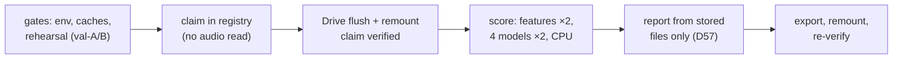

# Stage 11 — FoR internal test (once)

| | |
|---|---|
| **Stage** | 11 — FoR internal test, the one test-split run |
| **Owner** | Donia Mabrouk (D26, Part C) |
| **Reviewer(s)** | Khalil Dridi (Protocol v1.0 §7 reviewer); D32 teach-back: Khalil (required), Iheb and Malak (consumers: Stage 12 integration, Stage 14) |
| **Status** | Accepted — D32 teach-back: Khalil (required), Iheb and Malak, face to face, 2026-11-10; Donia attended as author, correcting only; no corrections to the brief; confirmed by approval of the closeout PR |
| **Date** | 2026-11-10 |
| **Related PRs** | #62 (D41 storage), #67 and #112 (D46), #68 (runner), #114 (report, D57), #116 (D56, ordering gate), #117 (D58), #115 (notebook 06), #118 (evidence and results) |

## 1. In one paragraph

Stage 11 measures the finished v1 system on the FoR **test** split, which no earlier stage touched,
and it does so exactly once (D31). Four models are scored on the same 2,658 clips: the MFCC/SVM
baseline `baseline-v1` and the three CNN seeds, with the bundle-seed CNN (seed 0) also passed
through the frozen risk policy `risk-v1` from Stage 10. The run is guarded in code: a registry
claim before the first test read, a second claim refused, every input checked against committed
hashes, and the per-clip outputs stored so that every later number (Stage 14, Stage 16) comes from
these files without a second test run. All reporting rules were fixed before the run (D57). The
result is an **in-domain** measurement: both models separate FoR's test clips almost perfectly, so
the pre-registered comparisons H1 and H5 are not supported. What this says about generalization is
the job of the DEEP-VOICE run (Stage 13, H2), not of this stage.

## 2. Inputs → outputs

| | What | From / to | Path |
|---|---|---|---|
| In | CNN seeds 0–2 (`cnn-v1`), `baseline-v1` (D41 hash `42cc4d53…`), `risk-v1` | Stages 7–10 (Donia) | Drive `checkpoints/…`; hashes in `docs/audit_evidence/stage{7_baseline,8_cnn,10_risk}/` |
| In | F2 manifest (test split: 1,320 REAL, 1,139 FAKE_mp3, 199 FAKE_other), F3 profile | Stages 5–6 (Malak) | `data/manifests/for2sec_frozen_manifest.csv`, `configs/preprocessing.yaml` |
| In | D58 MFCC reference (Stage 7's val-A/val-B MFCC rebuilt on a CPU runtime, byte-equal to Stage 7) | this stage, Entry 159 | Drive `processed/metadata/stage11/mfcc_reference/` |
| Out | Per-clip scores, 4 models × 2,658 rows (clip ID, label, D14 group, raw score; `p` and prediction where applicable) | Stage 14 (Malak), Stage 16 (Khalil), via D41 | Drive `processed/metadata/stage11/run/runner/clip_scores/` (bound by `run_report.json`) |
| Out | Registry with the one `stage11_test` claim, run evidence, metrics report | Reviewers, Stage 19 report | `docs/audit_evidence/run_registry.jsonl`, `docs/audit_evidence/stage11_run/` |
| Out | Results | Stage 12 (F4), Stage 19 | [results/stage11_for_test.md](../results/stage11_for_test.md) |

## 3. How it works, step by step



1. **Storage and registry first** (D41, PR #62): a per-clip file format and an append-only,
   hash-chained registry keyed by (dataset, split, purpose, model set); a second `stage11_test`
   claim for the same model set is refused in code ([clip_scores.md](../clip_scores.md),
   [evaluation_harness.md](../evaluation_harness.md) "Run registry").
2. **The run procedure** (D46, PRs #67/#112): T4 runtime, CPU scoring, an asserted environment, a
   reproduction gate on the caches, test features in memory only, a durable claim on Drive, and a
   pre-declared rerun rule.
3. **The runner** (PR #68, [stage11_run.md](../stage11_run.md)): `rehearse` (validation dry run with
   known answers), `claim` (all checks, then the registry claim, no audio) and `score` (once-only
   marker, checks again, features and scores computed twice and compared byte for byte, per-clip
   files, `complete`).
4. **The report** (PR #114, [stage11_report.md](../stage11_report.md)): integrity checks on the
   stored files, then D4 metrics, CIs, H1, H5 and seed rows, under the conventions D57 fixed before
   any result.
5. **Ordering gate** (D48 (6)): the v2 design, including D56 (RawBoost algorithm 1, PR #116), was
   approved before the claim, so no test result can shape model v2.
6. **The dry run found a real problem** (Entry 159): the T4 MFCC cache was not byte-equal to Stage
   7's. A validation-only diagnostic showed each cache reproduces only on the processor it was built
   on (Stage 7 on a CPU runtime without AVX-512, Stages 8 and 10 on the T4 with AVX-512). **D58**
   (PR #117) keeps the exact log-Mel gate and checks the baseline's MFCC against a CPU-built
   reference within a fixed tolerance, plus identical baseline decisions on validation. The runtime
   version is pinned to Colab 2026.10.
7. **Notebook 06** (PR #115): a `dry_run` mode that stops before the claim and an `official` mode;
   the runner writes straight to Drive so the once-only marker survives a crash. The second dry run
   passed.
8. **The official run** (2026-11-10, Entry 161): rehearsal passed, claim, flush and remount, score
   (≈ 3 minutes), report, export verified after a remount. Two incidents happened after the run's
   own writes (an interrupted output loop; an export resumed after a rebound name) and are recorded
   in Entry 161; neither touched scoring or test access.
9. **Results PR** (#118): evidence committed byte for byte; the report reproduced byte for byte from
   the stored files on the run's platform.

## 4. Key decisions and why

- **D31** — the test split is evaluated once, enforced by a registry: a result seen twice can be
  chosen; one run cannot.
- **D41 / D45** — store per-clip clean scores for all four models (`p` and prediction for the
  bundle seed and the baseline's D29 decision only): Stage 14 and 16 reuse them, no second clean pass.
- **D46** — claim before the first test read, durable on Drive, no rerun after the claim: reading
  test audio is test access.
- **D57** — reporting conventions fixed before the run (H5 on forced-binary recall, H1 as a paired
  EER difference, which metrics get CIs): no result could choose them.
- **D58** — exact log-Mel gate, tolerance gate for the baseline MFCC: the bytes are bound to the
  processor; the primary CNN keeps its byte-exact gate.
- **D29** — the baseline gets its own val-B EER threshold, forced binary only: a fair comparison
  without giving the evaluation-only baseline a policy.

## 5. Evidence

All from `docs/audit_evidence/stage11_run/` and [results/stage11_for_test.md](../results/stage11_for_test.md)
(Entry 161). **Test results, in-domain.**

- [verified] Run `d5306a55a77d4e9c85d237d959e3dbae`, commit `8219562`, Colab T4 runtime 2026.10
  (Python 3.13.16, torch 2.11.0+cu130), CPU scoring, batch 256, two passes — `run_report.json`,
  `stage11_export_manifest.json`.
- [verified] Registry: 2 lines (`started`, `completed`), hash chain intact, SHA-256 `b0133fc8…`
  — `run_registry.jsonl`, README "Binding". Report: 84 of 84 integrity checks — `metrics_report.json`.
- [verified] D58 gate on the run's T4: MFCC val-A within tolerance (max |Δ| 7.6e-6); baseline D29
  decisions from T4 and reference MFCC identical on val-A and val-B (max |Δ score| 4.7e-7 and 4.4e-7;
  one val-B clip within that distance of the threshold, still the same decision) — `rehearsal/rehearsal_report.json`.
- [verified] **H1 not supported:** EER baseline 0.0015, bundle CNN 0.00076; d = 0.00074, 95% CI
  [−0.0022, 0.0022] — `metrics_report.json` `hypotheses.H1`.
- [verified] **H5 not supported:** forced-binary recall 1.0 on FAKE_mp3 (1,139/1,139) and FAKE_other
  (199/199); d = 0 exactly, CI collapsed at 0 — `hypotheses.H5`.
- [verified] Forced binary: baseline 0 FP / 5 FN (4 FAKE_mp3, 1 FAKE_other); bundle CNN 3 FP / 0 FN
  (FPR 0.0023, CI [0, 0.0053]) — `models.*.forced_binary`, `ci`.
- [verified] Three-way (bundle CNN, `risk-v1`): bonafide 1,314 authentic / 0 synthetic / 6 uncertain;
  spoof 0 / 1,071 / 267; deferral 10.3% overall, 0.45% of REAL, 20.0% of spoof; no error on the
  2,385 non-deferred clips (1,071 TP, 1,314 TN, 0 FP, 0 FN) — `models.cnn-v1-seed0.three_way`.
- [verified] Seeds (score level): EER 0.00076 / 0.00149 / 0.00152, mean 0.0013 ± 0.0004 (sample SD);
  ROC-AUC ≥ 0.99996 for every seed — `seeds`.
- [verified] Reproduction from stored files only: byte-identical report on the run's platform;
  locally (Windows, Python 3.14) the exact `p` re-derivation differs by ≤ 1 ulp on 69 clips — Entry 161.

## 6. Limitations

- [doc] **In-domain only.** FoR test clips come from the same corpus, TTS systems and pipeline as
  train. Near-perfect numbers here are an upper bound, not an estimate of real-world or external
  behaviour (that is H2, Stage 13).
- [inference] **Ceiling effects make H1 and H5 weak tests.** With EERs of one or two clips and
  recall at 1.0, the CIs are wide (H1) or collapsed (H5). "Not supported" means "not shown", not
  "the CNN is no better" or "no MP3 reliance" (harness Step 4; 199 FAKE_other clips, threat model T5).
- [doc] **Other shortcuts are not tested here.** Bandwidth (H6, Stage 14), pauses (H7, Stage 16) and
  loudness (D43, Stage 16) are tested later from these stored files.
- [verified] **Asymmetric deferral.** The band defers 20% of fakes but 0.45% of genuine clips, as on
  val-B (Entry 94): one fake in five goes to MEDIUM instead of HIGH. Nothing changes because of it
  (D57, Protocol §12); Stage 18 must make "uncertain" clear to the analyst.
- [doc] **Baseline features are T4 MFCC** (D58 (5)): they differ from a CPU computation at float
  precision; validation decisions were identical, test clips near the threshold cannot be checked.
- [verified] **Each test clip is its own D14 group** (2,658 groups), so the cluster bootstrap is a
  row bootstrap here; the report is byte-reproducible only on the run's platform (Entry 161 open item).

## 7. Questions the professor may ask

1. **Q:** Why run the test split only once, and how is that enforced?
   **A:** If we could run it several times, we could keep the best run, and the test would stop
   being independent. D31 makes it once: an append-only, hash-chained registry gets a `started`
   record before any test audio is read, and the code refuses a second claim for the same model set
   and purpose. The registry is committed (`b0133fc8…`, 2 lines).
2. **Q:** H1 is "not supported". Is the CNN not better than the baseline?
   **A:** On FoR test, both are near-perfect: EER 0.15% vs 0.08%, about one or two clips. The CNN's
   EER is lower, but the paired 95% CI of the difference is [−0.22%, 0.22%] and includes 0, so the
   data cannot show a difference. It is a ceiling effect of in-domain data, not evidence that they
   are equal. The comparison that matters more is external (Stage 13).
3. **Q:** What did H5 test and what does the result mean?
   **A:** Whether the CNN relies on MP3 traces: 85% of FoR fakes have an MP3 step and REAL clips
   none (D16). If it did, its recall on FAKE_other (no MP3) would be clearly lower. Both recalls are
   1.0, so no gap. That rules out the strongest form of the shortcut at the decision level on FoR;
   with 199 clips at the ceiling it cannot rule out subtler reliance.
4. **Q:** Why is H5 measured on forced-binary recall and not on the non-deferred clips?
   **A:** D57 (5), fixed before the run: the band defers different shares of each subgroup, so
   non-deferred recalls would have denominators chosen by the model itself. Forced binary uses the
   whole subgroup. The non-deferred recall is still reported (1.0 for both).
5. **Q:** Why does the system defer 20% of fakes but almost no genuine recordings?
   **A:** The band was fitted on val-B to defer at most 10% overall (Protocol §6). The threshold sits
   just above almost all genuine scores, and the band's upper edge is p ≥ 0.997, so fakes with p between
   0.633 and 0.997 become "uncertain". Genuine clips are rarely in the band. For fraud prevention
   that errs on the safe side: no genuine caller was called synthetic; some fakes need review.
6. **Q:** The dry run failed. Why was changing the gate (D58) allowed, and why is it not post-hoc?
   **A:** The dry run reads validation data only; no test result existed. The failure was a
   provenance problem (bytes depend on the processor), not a result. D58 was proposed, approved by
   all four and merged before the claim, with its tolerance fixed before the difference was
   computed. A change after a test result would need a decision and be labelled exploratory.
7. **Q:** Why score on CPU when the runtime has a GPU?
   **A:** The risk policy was fitted on CPU logits (Stage 10), so test `p` and decisions use the
   same computation, and CPU inference is deterministic: features and scores were computed twice
   and had to be byte-identical. The T4 runtime is required only because its processor reproduces
   Stage 8's log-Mel bytes.
8. **Q:** What happened when the cell showed `KeyboardInterrupt`, and why is the run still valid?
   **A:** The laptop slept, a key was pressed in the tab, and the notebook's output loop stopped. The
   runner is a separate process and had already written everything and recorded `completed`
   (16:21:50 UTC). A read-only check confirmed it; the post-score assertions then passed; no second
   `score` was attempted. Recorded in Entry 161.
9. **Q:** How do we know the published numbers are what the code computes?
   **A:** The report reads only the stored files and checks 84 integrity conditions first. Rebuilt
   from those files on the run's platform, `metrics_report.json` and `.md` are byte-identical to
   the stored ones. Locally on Windows the exact `p` re-derivation differs by 1 ulp on 69 clips (no
   decision change), the same processor effect as D58.
10. **Q:** What does Stage 11 hand to the next stages?
    **A:** Stage 12 freezes `risk-v1`, the bundle-seed checkpoint and F3 as ModelBundle v1 (F4);
    nothing in them changes because of these results. Stages 14 and 16 read the stored per-clip
    scores (D41, D43), and Stage 13 runs the same models once on DEEP-VOICE.

## 8. How to verify or re-run it

Tests (synthetic, no data): `python -m pytest -q tests/evaluation/test_stage11_run.py
tests/evaluation/test_stage11_report.py tests/governance/test_notebook_06_stage11.py`. Check the
committed evidence (prints `True` on every line):

```python
import hashlib, json
from pathlib import Path
d = Path("docs/audit_evidence/stage11_run"); h = lambda p: hashlib.sha256(Path(p).read_bytes()).hexdigest()
man = json.loads((d / "stage11_export_manifest.json").read_bytes())
local = {"run/runner/" + n: d / n for n in ("claim.json", "environment.json", "environment_score.json",
         "pip_freeze.txt", "scoring_started.json", "run_report.json")}
local |= {"run/metrics_report.json": d / "metrics_report.json", "run/metrics_report.md": Path("docs/results/stage11_for_test.md"),
          "run/rehearsal/rehearsal_report.json": d / "rehearsal/rehearsal_report.json"}
for f in man["files"]:
    key = f["path"].split("stage11/", 1)[1]
    if key in local: print(key, h(local[key]) == f["sha256"])
reg = Path("docs/audit_evidence/run_registry.jsonl")
lines = reg.read_bytes().splitlines(keepends=True)
print("registry", h(reg) == man["registry"]["sha256"] and len(lines) == 2,
      json.loads(lines[1])["prev_sha256"] == hashlib.sha256(lines[0]).hexdigest())
m = json.loads((d / "metrics_report.json").read_bytes())
print("checks", len(m["checks"]) == 84 and all(c["passed"] for c in m["checks"].values()))
print("H1/H5", m["hypotheses"]["H1"]["outcome"] == m["hypotheses"]["H5"]["outcome"] == "not supported")
```

The run itself cannot be repeated (D31). The report can be recomputed from the stored files with
`python -m src.evaluation.stage11_report` (command in the evidence README); byte-identical output
needs the run's platform (Colab T4, runtime 2026.10).
