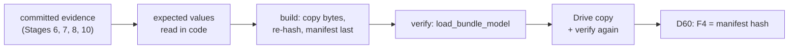

# Stage 12 — ModelBundle v1 freeze (F4)

| | |
|---|---|
| **Stage** | 12 — ModelBundle v1 freeze (F4) |
| **Owner** | Donia Mabrouk (D26, Part C) |
| **Reviewer(s)** | D32 teach-back: Iheb Zemzemi (C→E consumer: API) and Khalil Dridi (C→D consumer: Stage 13), required; Malak Ben Salem |
| **Status** | In review |
| **Date** | 2026-11-15 |
| **Related PRs** | #19 (bundle format, Entry 35), #123 (D59 layout), #124 (F4 tool), #125 (F4 evidence, D60) |

## 1. In one paragraph

Stage 12 packs the finished v1 system into one frozen, verifiable artifact, the **ModelBundle**:
the CNN checkpoint (Stage 8, bundle seed 0), the preprocessing profile (F3, Stage 6) and the risk
policy (`risk-v1`, Stage 10), with a manifest that records the SHA-256 of every file (Protocol v1.0
§6, §12; AGENTS.md hard rule 2). The bundle is what the API loads and what the DEEP-VOICE run
scores with, so both must use exactly the same model, profile and thresholds that FoR validated.
Every file is copied byte for byte from its source, nothing is re-trained or re-fitted, and no audio
is read. The loader refuses to start if any hash, file or version does not match. The freeze **F4**
is the manifest hash `edf4a205…40efc` (D60): any later change is a new bundle with a new version and
a new decision.

## 2. Inputs → outputs

| | What | From / to | Path |
|---|---|---|---|
| In | CNN checkpoint `cnn-v1`, bundle seed 0 (`checkpoint.json` + `weights.safetensors`, combined hash `c33eb820…`) | Stages 8–9 (Donia) | Drive `checkpoints/cnn/cnn-v1/seed_0/`; hashes in `docs/audit_evidence/stage8_cnn/` |
| In | Preprocessing profile `preprocessing-v1` (F3, fingerprint `5b4f5849…`) | Stage 6 (Malak) | `configs/preprocessing.yaml` |
| In | Risk policy `risk-v1` (`a74f1f51…`) | Stage 10 (Donia) | `docs/audit_evidence/stage10_risk/risk_policy.json` |
| Out | **F4** = `bundle-v1`, manifest SHA-256 `edf4a205…40efc` | **C→E**: API (Iheb, P1); **C→D**: Stage 13 (Khalil) | Drive `checkpoints/bundle/bundle-v1/` |
| Out | Freeze record (29 checks, every component hash, `baseline-v1` hash beside it) | Reviewers, Stage 13, Stage 19 | `docs/audit_evidence/stage12_bundle/` |

`baseline-v1` is **not** in the bundle (D36, D7: it is for evaluation only); its artifact hash
`42cc4d53…` is recorded next to F4 so Stage 13 scores the same baseline.

## 3. How it works, step by step



1. **Format and verifying loader** (PR #19, [model_bundle.md](../model_bundle.md)): one folder with
   the manifest, `policy.json`, the profile and the checkpoint; strict manifest; plain file names
   only (no path tricks); the bytes that are hashed are the bytes that are parsed.
2. **D59 layout** (PR #123): the Stage 8 checkpoint is two files whose identity is a combined hash
   (D42). The bundle keeps them as a `checkpoint/` folder and records both file hashes and the
   combined hash, which must equal Stage 8's `c33eb820…`. `load_bundle_model` loads the CNN through
   the reviewed non-pickle loader, from the verified bytes.
3. **F4 tool** (PR #124, `python -m src.bundle.f4 build|verify`): it types no expected value; it
   reads each one from the committed evidence and cross-checks the sources (e.g. the checkpoint hash
   from Stage 8 against the Stage 10 run report).
4. **Build** (2026-11-12, local, clean `main` at `ea5544a`): copy, re-hash, write the manifest last,
   then load everything back with `load_bundle_model`: `F4 build OK`, 29/29 checks.
5. **Drive copy verified:** uploaded, downloaded again, `verify` → `F4 verify OK` (Entry 168).
6. **Freeze** (D60, PR #125): the manifest and the record are committed (not the checkpoint, rule 7);
   the manifest reproduces byte for byte from the committed evidence, commit and date.
7. **Hand-over** (2026-11-15): Iheb and Khalil each ran `verify` on their own copy and got
   `manifest_sha256: edf4a205…40efc` and `F4 verify OK`.

## 4. Key decisions and why

- **D2** — model, profile and policy are frozen together before the external run: a threshold or
  profile changed after seeing DEEP-VOICE would make H2 meaningless.
- **D36 / D7** — the baseline stays outside the bundle but its hash is recorded: it is evaluated,
  never deployed.
- **D59** — the checkpoint is kept as its own folder with its recorded combined hash: the model's
  identity stays the Stage 8 bytes, and the reviewed loader is reused unchanged.
- **D60** — F4 = manifest hash `edf4a205…`: a file cannot contain its own hash, so the decision is
  the external anchor that detects an edited manifest.
- **D48 (5)** — F4 replaces the mock in the API and is the v1 model set of the Stage 13 joint run.

## 5. Evidence

- [verified] F4 manifest SHA-256 `edf4a205e12fc948a68575ebaa929145481aaa535d34e3353ef9535f92840efc`,
  1,027 B, schema 2, `created_at` 2026-11-12T22:40:45Z, `code_commit` `ea5544a` — source:
  `docs/audit_evidence/stage12_bundle/bundle_manifest.json` (Entry 168, D60).
- [verified] 29/29 checks `ok` (sources cross-checked, both checkpoint files by size and hash, every
  manifest value, the model loaded) — source: `f4_record.json` `checks` (`b8f0f539…`).
- [verified] Components: checkpoint `c33eb820…` (`checkpoint.json` `dc0f8b0e…`, 1,350 B;
  `weights.safetensors` `6722f858…`, 396,084 B), profile `7bd35bfd…`, policy `a74f1f51…`, F2 ledger
  `c9fc2e23…` — source: `bundle_manifest.json`, `stage12_bundle/README.md`.
- [verified] The manifest is reproduced byte for byte from the committed evidence at `ea5544a`
  (independent review on Linux) — source: `stage12_bundle/README.md` "How it was checked".
- [verified] Drive copy: `F4 verify OK` (Entry 168); hand-over copies: Iheb and Khalil,
  `manifest_sha256: edf4a205…40efc`, `F4 verify OK`, 2026-11-15 (Entry 174).
- [verified] `pytest -q tests/bundle`: 122 passed, 1 skipped (the Windows symlink case) — Entry 167.

## 6. Limitations

- [doc] **The bundle proves identity, not quality.** It guarantees that the API and Stage 13 use the
  validated v1 system; how good that system is on new data is Stage 13's question (H2).
- [doc] **Profile by path.** Callers must use `LoadedBundle.profile` (parsed from the verified
  bytes), never re-read `profile_path` ([model_bundle.md](../model_bundle.md), Limitations).
- [doc] **`load_bundle` hashes but does not parse the weights;** scoring must go through
  `load_bundle_model`, which parses and checks them.
- [doc] **The API integration is not part of this stage's evidence:** replacing `MockAnalyzer` with
  F4 is Iheb's P1 (Stage 17, planned 2026-11-24); until then the web app stays mock-labelled.
- [doc] **The checkpoint is not in Git** (rule 7): F4's bytes live on Drive; the committed manifest
  and record are what any copy is checked against.

## 7. Questions the professor may ask

1. **Q:** Why freeze anything before the external run?
   **A:** If the threshold, profile or model could change after seeing DEEP-VOICE results, the
   external number would be tuned on the test set (D2, AGENTS.md rule 2).
2. **Q:** What exactly is "F4"?
   **A:** The SHA-256 of `bundle_manifest.json`, `edf4a205…40efc` (D60). The manifest holds every
   component's hash, so one hash pins all of them.
3. **Q:** Why can the manifest not just contain its own hash?
   **A:** Writing the hash changes the file, so the hash changes. The anchor is recorded outside, in
   D60 and the evidence folder.
4. **Q:** What happens if someone replaces `policy.json` with a looser threshold?
   **A:** Its SHA-256 no longer matches the manifest, so `load_bundle` raises and nothing is
   loaded; once F4 is in the API (Iheb, P1), the API refuses to start.
5. **Q:** Why is the checkpoint a folder of two files?
   **A:** D42 saves weights as safetensors (no pickle) plus strict JSON metadata; their combined hash
   is the model's identity since Stage 8. D59 keeps those exact bytes and that hash.
6. **Q:** Why is the baseline not in the bundle?
   **A:** It is an evaluation reference, never deployed (D7); its hash is recorded beside F4 (D36) so
   Stage 13 scores the same baseline.
7. **Q:** How do Iheb and Khalil know their copy is the frozen one?
   **A:** `python -m src.bundle.f4 verify` must print the F4 hash and `F4 verify OK`; both did on
   2026-11-15.
8. **Q:** Does building the bundle touch any data?
   **A:** No. It copies three already-frozen artifacts and checks hashes; no audio, cache or score is
   read.
9. **Q:** What does model v2 change here?
   **A:** Nothing in F4. v2 becomes a new bundle, F5, with the same layout and hash rule (D59 (7)),
   its own manifest hash and decision.

## 8. How to verify or re-run it

```bash
python -m pytest -q tests/bundle
# with a downloaded copy of Drive checkpoints/bundle/bundle-v1/ (outside the repository):
python -m src.bundle.f4 verify --bundle <copy>/bundle-v1 --record docs/audit_evidence/stage12_bundle/f4_record.json
```

Expected: the tests pass, and `verify` prints `manifest_sha256: edf4a205…40efc` and `F4 verify OK`.
Anything else means the copy is not F4: do not use it. Load it only with
`src.bundle.model_loader.load_bundle_model`.
