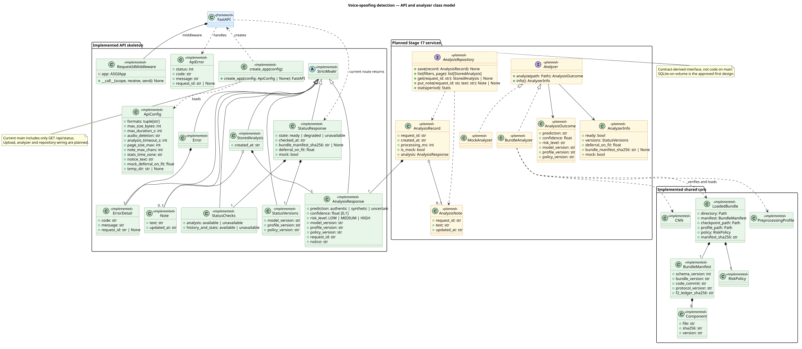
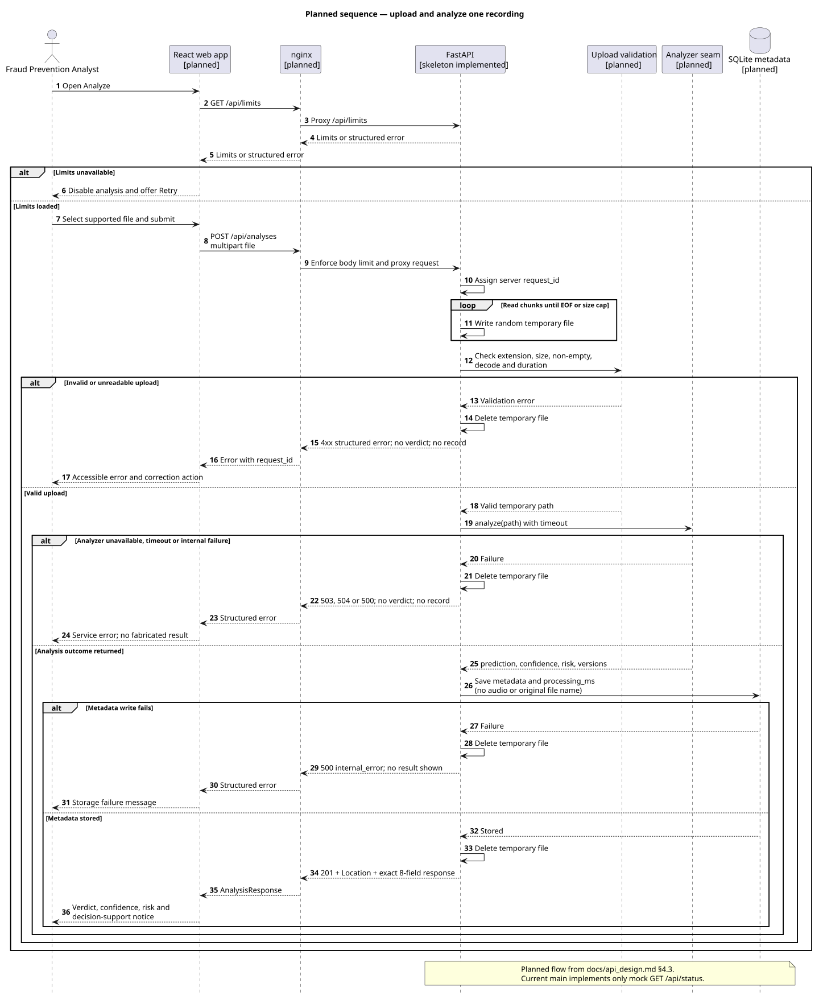
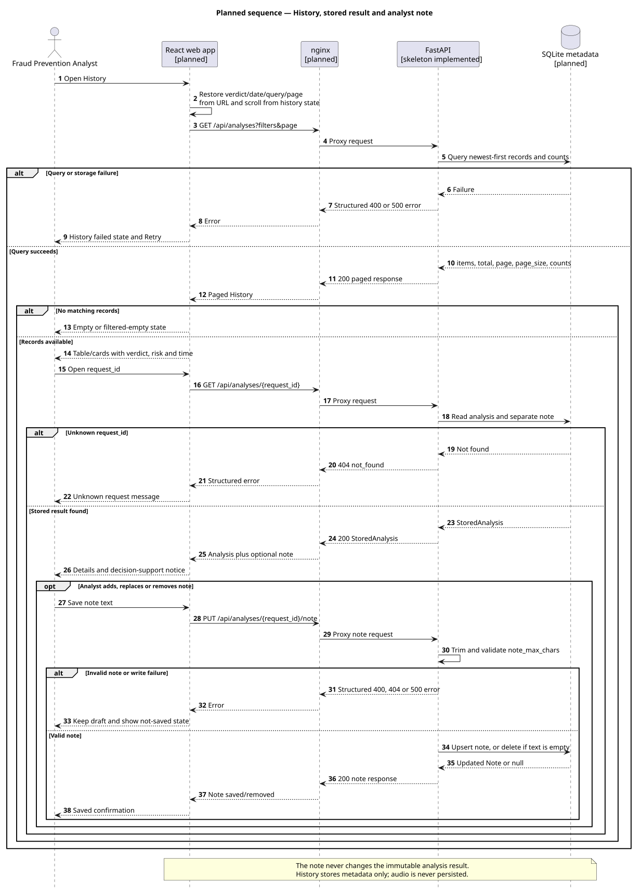
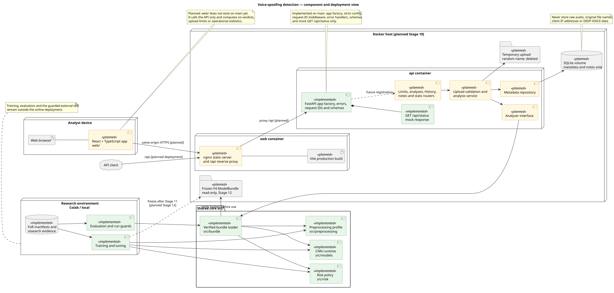

# Midterm UML package

**Snapshot:** 2026-10-31, `main` at `023bfa4` (PR #69).

This package documents the voice-spoofing system that the team is carrying into the midterm. It
does not add requirements. The diagrams distinguish code that exists on this snapshot from
approved but not-yet-implemented Stage 17–19 design.

## Status notation

- **Implemented:** present in the repository at this snapshot.
- **Planned:** approved by an existing requirement, decision or design note, but not implemented on
  `main` yet.
- **Framework:** an external runtime type shown only to explain composition.
- **Open decision:** approved documents reserve the capability, but the team has not chosen the
  mechanism yet.

The only implemented online endpoint in this snapshot is the mock `GET /api/status`. The analyzer
seam, uploads, metadata storage, History, notes, statistics, React app, nginx container and Docker
deployment remain planned. A prototype or contract is design evidence, not working-MVP evidence.

## Diagrams

| Diagram | Editable source | Rendered image | Scope |
|---|---|---|---|
| Use cases | [`use-case.puml`](use-case.puml) | [`use-case.svg`](use-case.svg) | Approved analyst, API-client and operations capabilities; implemented/planned status is explicit. |
| Class model | [`class-diagram.puml`](class-diagram.puml) | [`class-diagram.svg`](class-diagram.svg) | Implemented API schemas/configuration and bundle types, plus the planned analyzer and storage seams. |
| Analyze sequence | [`sequence-analysis.puml`](sequence-analysis.puml) | [`sequence-analysis.svg`](sequence-analysis.svg) | Planned upload → validation → analysis → metadata persistence → result flow, including failure paths. |
| History sequence | [`sequence-history.puml`](sequence-history.puml) | [`sequence-history.svg`](sequence-history.svg) | Planned filtered History, stored result retrieval and separate analyst-note update flow. |
| Component/deployment | [`component-deployment.puml`](component-deployment.puml) | [`component-deployment.svg`](component-deployment.svg) | Research/online separation, shared core, planned two-container deployment and metadata-only storage. |

## Source traceability

The package was derived from these existing repository sources:

- `docs/reference/SRS_Voice_Spoofing_Detection.pdf`: FR-01–FR-20 and NFR-01–NFR-11.
- `docs/reference/Execution_Plan.md` and `AGENTS.md`: stages, ownership and shared-core boundaries.
- `docs/midterm/backlog.md`: closed requirement list, status and remaining work.
- `docs/architecture.md`: research tier, online tier, shared core and metadata-only storage.
- `docs/decisions/0008-web-frontend-react.md` (D38): React/Vite, nginx, two containers and UI scope.
- `docs/api_design.md`: `/api` endpoints, validation order, analyzer seam, storage and errors.
- `docs/design/HANDOFF.md`: approved screens, routes and navigation behaviour.
- `api/`: implemented FastAPI skeleton, request-ID middleware, strict configuration, error handling,
  response schemas and mock status route.
- `src/bundle/`, `src/preprocessing/`, `src/models/` and `src/risk/`: implemented shared-core types
  used by the future production analyzer.

When a lower-priority source differs from an approved decision, the decision register wins, as
required by `AGENTS.md`. In particular, the approved API uses `POST /api/analyses`, not the older
SRS/Execution Plan path, and D38 replaces Streamlit with React.

## Important boundaries and assumptions

1. The web app calls the API only and contains no detector logic.
2. The API is the only source of verdicts, upload limits and operational statistics.
3. Uploaded audio and original file names are never stored; temporary audio is deleted when the
   request ends. Metadata and analyst notes use separate records.
4. The online analyzer will load the frozen F4 `ModelBundle` after Stage 12. The current API still
   reports mock status values and has no analyzer implementation.
5. Access control/sign-in remains an open decision. It is shown as a planned boundary, not as an
   implemented class or endpoint.
6. DEEP-VOICE, research evaluation and training do not exist in the online deployment.

## Render and validate

The sources use PlantUML so standard UML actors, use cases, stereotypes, classes, interfaces,
components, nodes and sequence fragments remain editable.

```powershell
java -Djava.awt.headless=true -jar plantuml.jar -checkonly docs/uml/*.puml
java -Djava.awt.headless=true -jar plantuml.jar -tsvg docs/uml/*.puml
```

Before this package is accepted:

- Iheb validates the API, React, storage and deployment flows against the current Part E work.
- Donia validates the analyzer, ModelBundle, preprocessing and risk-policy boundaries.
- Any correction changes both the `.puml` source and its matching `.svg`.

## Use-case diagram


## Class diagram



## Analyze sequence



## History and result sequence



## Component and deployment diagram


