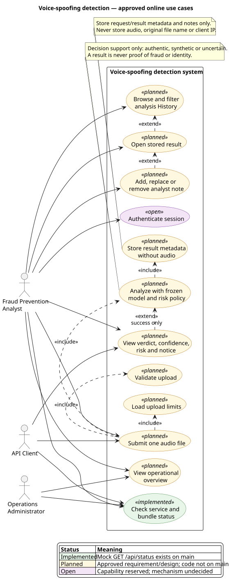
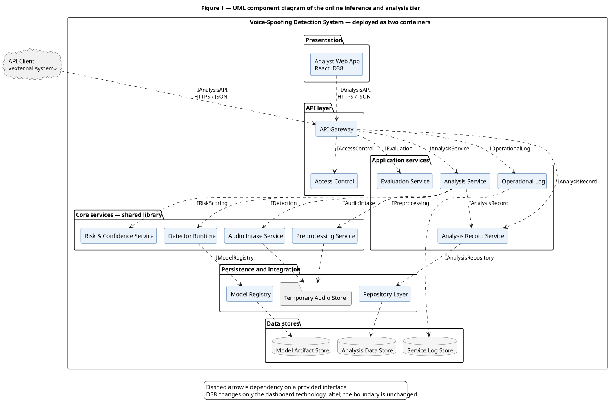
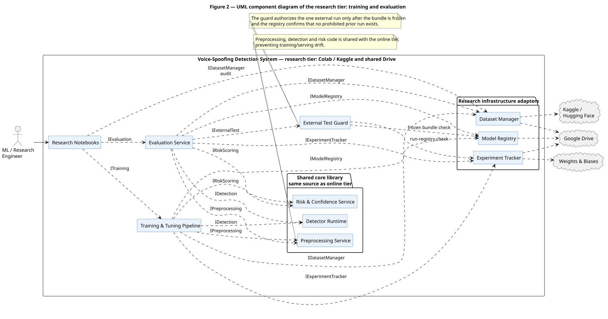
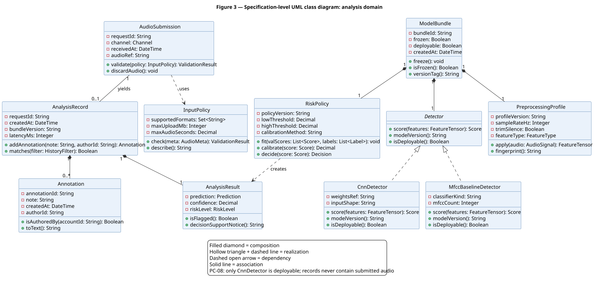
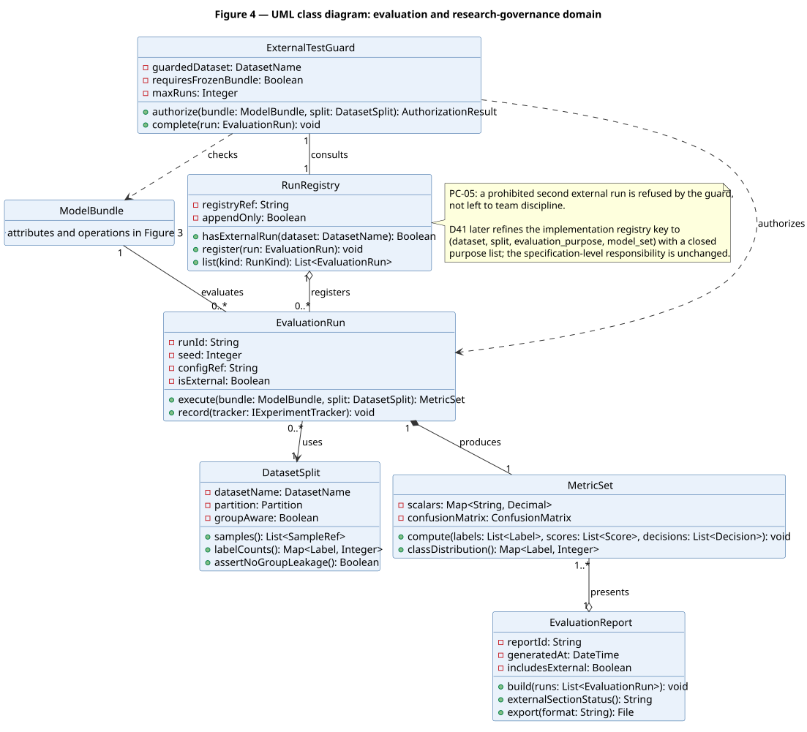
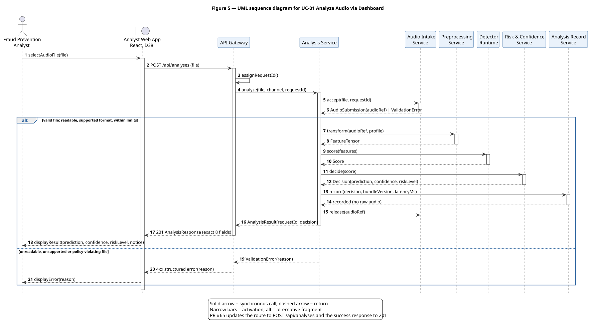
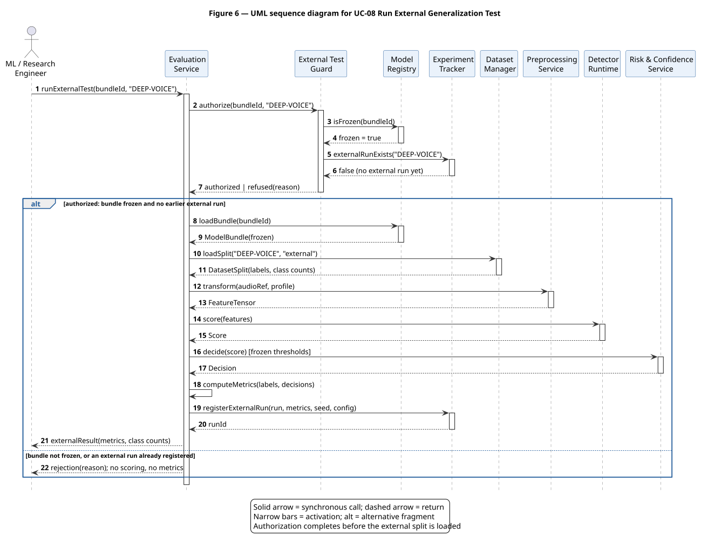

# Canonical UML package

**Snapshot:** 2026-10-31, prepared from `main` at `023bfa4` (PR #69).

This folder is the single editable UML package for the midterm submission. It reconstructs the
approved figures already published in the SRS and SDD; it does not define a second model and does
not add requirements.

## Canonical source figures

| Repository diagram | Canonical report figure | Editable source | SVG export |
|---|---|---|---|
| Merged use-case model | SRS v3.0, Figure 1 | [`use-case.puml`](use-case.puml) | [`use-case.svg`](use-case.svg) |
| Online component view | SDD v1.0, Figure 1 | [`component-online.puml`](component-online.puml) | [`component-online.svg`](component-online.svg) |
| Research component view | SDD v1.0, Figure 2 | [`component-research.puml`](component-research.puml) | [`component-research.svg`](component-research.svg) |
| Analysis-domain classes | SDD v1.0, Figure 3 | [`class-analysis.puml`](class-analysis.puml) | [`class-analysis.svg`](class-analysis.svg) |
| Evaluation/governance classes | SDD v1.0, Figure 4 | [`class-evaluation.puml`](class-evaluation.puml) | [`class-evaluation.svg`](class-evaluation.svg) |
| UC-01 Analyze Audio | SDD v1.0, Figure 5 | [`sequence-uc01-analysis.puml`](sequence-uc01-analysis.puml) | [`sequence-uc01-analysis.svg`](sequence-uc01-analysis.svg) |
| UC-08 External Generalization Test | SDD v1.0, Figure 6 | [`sequence-uc08-external-test.puml`](sequence-uc08-external-test.puml) | [`sequence-uc08-external-test.svg`](sequence-uc08-external-test.svg) |

The detailed use-case descriptions, responsibility tables, class-design table, interface contracts,
logical data model and sequence-message lists remain in the source reports under `docs/reference/`.

## Controlled post-report updates

The diagrams preserve the report's actors, use-case IDs, components, classes, relationships,
participants and message order. Only these approved later decisions are reflected:

1. **D38 / ADR 0008:** the generic Analyst Dashboard is labelled as the React analyst web app.
   Its responsibility and dependency direction do not change.
2. **Approved API contract (PR #65):** UC-01 submits to `POST /api/analyses` and receives `201` with
   the frozen eight-field response, replacing the older `/analyze-audio` label. This is a contract
   rename, not a new use case.
3. **D41 / ADR 0010:** the evaluation class diagram keeps the SDD's specification-level
   `RunRegistry` relationship and records the later purpose-key refinement in a note. It does not
   create a second registry class.

Implementation status is deliberately not mixed into these specification-level UML figures. The
current implementation status belongs in `docs/midterm/backlog.md` and `docs/project_log.md`.

## Consistency rules

- UML names match the SRS/SDD names unless a controlled update is listed above.
- Both submission channels include the same `Validate & Analyze Audio` use case.
- `Annotate Result` extends `Review Analysis History`; annotation never changes the analysis result.
- The dashboard/web app and API client reach detector logic only through the API Gateway.
- The online and research tiers reuse the same preprocessing, detector, risk and model-registry
  boundaries.
- The baseline detector is evaluation-only; only the CNN is deployable.
- No online component reads DEEP-VOICE. UC-08 is controlled by the External Test Guard and
  RunRegistry/Experiment Tracker.
- Audio is temporary; `AnalysisRecord` stores result metadata and annotations, never raw audio.

## Render and validate

The sources use PlantUML and are the editable originals for the SVGs committed beside them.

```powershell
java -Djava.awt.headless=true -jar plantuml.jar -checkonly docs/uml/*.puml
java -Djava.awt.headless=true -jar plantuml.jar -tsvg docs/uml/*.puml
```

Any change to a `.puml` file must regenerate and review the matching `.svg`. A semantic change to a
canonical figure requires an approved requirement or decision; layout-only corrections do not.

## Review ownership

- Iheb validates the React/API/online-component and UC-01 flow against Part E.
- Donia validates the preprocessing, detector, risk, bundle and evaluation boundaries.
- Khalil validates the External Test Guard, UC-08 and reporting/governance view.
- Malak owns the editable UML package and verifies that it remains aligned with the reports.

## Merged use-case model



## Online component view



## Research component view



## Analysis-domain class diagram



## Evaluation and research-governance class diagram



## UC-01 sequence



## UC-08 sequence


